

# kobra-spoolman

**Spoolman als einzige Quelle für alle Filamentdaten eines Anycubic Kobra S1 mit ACE 2 Pro – in OrcaSlicer, im Browser, auf dem Handy und am Drucker.**

Läuft auf der **Original-Firmware mit [Rinkhals](https://github.com/rinkhals-community/Rinkhals)** und mit **Klipper auf einem Raspberry Pi** und ACEPRO – eine Bridge, sie erkennt selbst, mit wem sie spricht.

[English](README.md) · [Hier anfangen](docs/de/start.md) · [Installation](docs/de/installation.md) · [Alltag](docs/de/usage.md) · [Fehlersuche](docs/de/troubleshooting.md) · [API (englisch)](docs/api.md) · [KI-Hinweis](#ki-hinweis)

---

Du trägst ein Filament **einmal** in [Spoolman](https://github.com/Donkie/Spoolman) ein – Temperaturen,
Lüfter, Hilfslüfter, Abluft, Flow, Pressure Advance, Retraction. Ab dann:

- **OrcaSlicer** hat ein passendes Filamentprofil, automatisch angelegt und aktuell gehalten; ein
  Klick auf Orcas Sync-Knopf setzt die richtigen Profile in die richtigen ACE-Slots.
- Jeder Druck **bucht den Verbrauch pro Spule** in Spoolman – am Drucker gemessen, inklusive Laden und Spülen,
  auf den Millimeter genau.
- Eine **Weboberfläche** (Handy, Desktop, Ultrawide) und eine **Android-App** zeigen Drucker, die vier
  ACE-Slots und das Regal; du ordnest Spulen zu, legst Spulen und Filamente mit allen Orca-Werten an
  und steuerst den **ACE-Trockner** – ohne Spoolmans eigene Oberfläche.
- Änderst du ein Profil in Orca, landet die Änderung nach Rückfrage **in Spoolman**.
- Nach dem Slicen zeigt das Orca-Panel, **wie viel jede Spule braucht**, und warnt, wenn eine nicht reicht.
- Die Bridge ist auch ein **Druckermonitor, der OctoApp ersetzt**: Kamera-Restream, der die
  Drucker-CPU schont, **was der Drucker gerade macht** (*Vorheizen 5/15 min*, *Wechsel auf Slot 2 · lädt*,
  *Druckt · Schicht 34/120*), Pause/Abbrechen/Nachjustieren, Terminal und Logs, Benachrichtigungen aufs
  Handy – und Spulen mit unseren NFC-Tags werden beim Einlegen **von selbst ihrem Slot zugeordnet**.
- Eine optionale **KI** beobachtet laufende Drucke und schlägt mit Kamerabild Alarm, wenn ein Druck zu
  Spaghetti wird – auf der CPU, ohne Last am Drucker ([vision.md](docs/vision.md), englisch).
- **Unter Rinkhals** zeigt und stellt die ACE-Karte, was das Drucker-Display versteckt: Endlosspule,
  Auslauferkennung und den **Spül-Multiplikator der Firmware mit Vorschau je Farbpaar**; die Verbrauchsvorschau in Orca
  rechnet das Spülen der Firmware mit ein.
- **Unter Klipper** steuern die Filamentdaten zusammen mit Klipper-Modulen am Drucker (nicht Teil dieses Repos) den
  Druck selbst: **Auto-PA**, von der Wiegezelle gemessen und pro Filament gespeichert, **Z-Versatz pro
  Filament**, **Fortsetzen nach Stromausfall** (tastet die Höhe auf dem Teil an, fragt immer vorher) und
  **Verstopfung erkennen** (Extruder gegen Filament-Encoder) – jedes mit eigenem Aus-Schalter.
- Eine Ansicht fürs **Display des Druckers** (`/display`, 800×480): Status, eine Druckansicht, die bei Druckstart
  von selbst kommt, mit dem Vorschaubild der Datei, und alle Schalter – angezeigt von einem Kiosk-Browser auf dem
  Klipper-Pi.
- Die Bridge **weiß, wie feucht jede Spule ist** – Feuchte-Verlauf der ACE, jede Trocknung, eine
  Feuchte-Schätzung pro Spule aus dem, wo sie lag –, trocknet Spulen beim Einlegen von selbst und prüft
  beim Druckstart, ob die eingelegten Spulen zur Datei passen.
- **3D-Ansicht** des laufenden Drucks in den Spulenfarben, **Home Assistant** über MQTT, ein
  **Widget** für den Startbildschirm, und jede Bridge-Einstellung lässt sich in der Weboberfläche ändern.
- **Englisch und Deutsch** in Weboberfläche, App und Orca-Panel – jeder Nutzer und jedes Gerät wählt seine Sprache.

  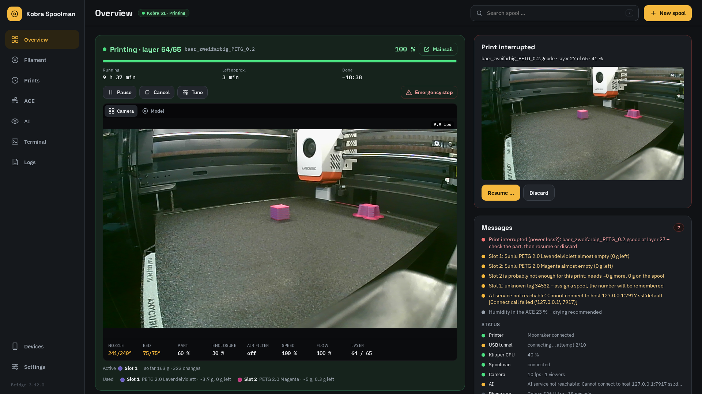 
  Weboberfläche: der Druckermonitor – Kamera und Druckerdaten, Meldungen und Status, Trockner, ACE, die vier Slots

<table>
  <tr>
    <td align="center">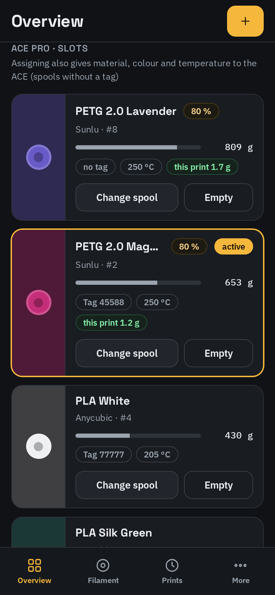 Weboberfläche auf dem Handy</td>
    <td align="center">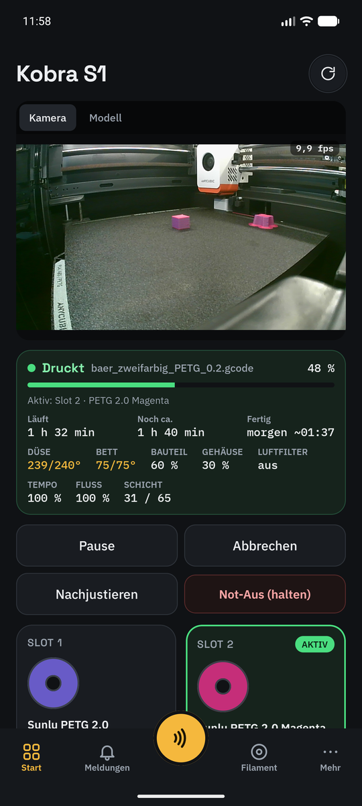 Android-App</td>
    <td align="center">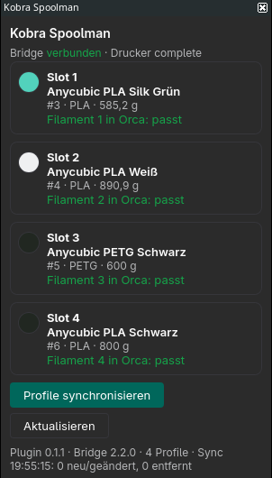 Orca-Seitenpanel</td>
  </tr>
</table>

## So funktioniert es

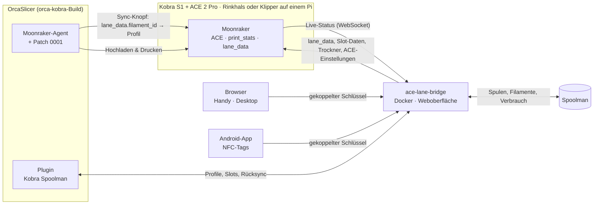

Die Bridge ist der **einzige** Client dieses Projekts an Moonraker und verteilt die Daten weiter: Browser,
App, Orca-Plugin und Home Assistant reden alle mit der Bridge. Welche Firmware läuft, liest sie aus Moonraker
(Rinkhals' `mmu`/`filament_hub` oder ACEPROs `ace`) und spricht die ACE passend an – nichts einzustellen.

| Baustein | Aufgabe |
|---|---|
| **[ace-lane-bridge](bridge/)** (Docker) | Verbindet Moonraker und Spoolman. Weboberfläche, Slot-Zuordnung (automatisch per NFC-Tag), `lane_data` für Orca, Verbrauch messen und pro Spule buchen, offene Posten, Druckhistorie, Trockner-Automatik und ACE-Einstellungen (Endlosspule), Feuchte-Verlauf und Feuchte-Schätzung pro Spule, Prüfung beim Druckstart, Kamera-Restream, 3D-Druckansicht, Drucksteuerung, Terminal und Logs, Meldungen, Einstellungen im Betrieb, Home Assistant über MQTT, Geräte koppeln, Schnittstelle für App und Plugin, liefert das App-Update aus. |
| **[Kobra Spoolman](orca-plugin/)** (Orca-Plugin) | Ein Orca-Filamentprofil pro Spoolman-Filament (`SM000010` …), Seitenpanel mit Slots und Profilprüfung, Verbrauchsvorschau nach dem Slicen, Rücksync von Profiländerungen nach Spoolman. |
| **[Android-App](android/)** | Drucker mit Kamera, 3D-Ansicht und Steuerung, Benachrichtigungen im Hintergrund, Widget, Slots, Spulenkarte, neue Spulen und Filamente, ACE-Trockner mit Feuchte-Verlauf und -Einstellungen, Feuchte der Spulen, schreibt ACE-taugliche NFC-Tags (zwei pro Spule), Koppeln per QR-Code, Updates über die Bridge. |
| **[kobra-vision](vision/)** (Docker, optional, AGPL-3.0) | KI-Fehldruck-Erkennung: Obicos Fehldruck-Modell mit ONNX Runtime (CPU, ~50 ms pro Bild), die Bridge bewertet die Ergebnisse über die Zeit. |
| **[spoolman_setup.py](spoolman/)** | Legt einmalig die Spoolman-Zusatzfelder (alle Orca-Filamentwerte) und Materialvorlagen an. |
| **[orca-kobra](https://github.com/xNoVoSx/orca-kobra)** (eigenes Repo) | Nächtliches OrcaSlicer-AppImage mit vier kleinen Patches: Profilwahl über `lane_data.filament_id` ([PR #14423](https://github.com/OrcaSlicer/OrcaSlicer/pull/14423)), Slice-Statistik für Plugins, eine Mindestgröße für angedockte Plugin-Panels und die richtigen Temperaturen der ersten Schicht im G-Code-Kopf. Aktualisiert sich selbst. |

## Voraussetzungen

Du brauchst **einen** der beiden Drucker-Aufbauten:

| | **A – Original-Firmware + Rinkhals** (am einfachsten) | **B – Klipper auf einem Raspberry Pi** |
|---|---|---|
| Drucker | Kobra S1 + ACE 2 Pro, Anycubic-Firmware mit [Rinkhals](https://github.com/rinkhals-community/Rinkhals) | Kobra S1 + ACE 2 Pro, Platinen per USB zum Pi getunnelt ([vanilla-klipper-swu](https://github.com/Kobra-S1/vanilla-klipper-swu), [klipper-kobra-s1](https://github.com/Kobra-S1/klipper-kobra-s1)), ACE am Pi mit [ACEPRO](https://github.com/Kobra-S1/ACEPRO) |
| Moonraker | Moonraker von Rinkhals auf dem Drucker, Port 7125 | Moonraker auf dem Pi, Port 7125 |
| Zusätzliche Hardware | keine | Raspberry Pi, USB-Kabel |
| Aufwand | Rinkhals installieren, fertig | ein Wochenende |

Für beide:

- **Spoolman** 0.26 oder neuer.
- Ein **Docker**-Host im selben Netz (Portainer, Compose, …) – oder Home Assistant mit dem Community-
  [Add-on](https://github.com/MineTech13/ha-addons) (Weboberfläche in der HA-Seitenleiste).
- **OrcaSlicer** mit Plugin-System (2.5.0-dev nightly). Die automatische Profilwahl braucht den
  `orca-kobra`-Build (Linux-AppImage), bis PR #14423 in Orca übernommen ist.
- Optional: ein Android-Handy (ab Android 10) mit NFC für die App.

Andere Rinkhals-Drucker mit ACE (Kobra 3 und Co.) nutzen dieselbe Rinkhals-Schnittstelle und sollten laufen, sind hier
aber nicht getestet – Rückmeldungen sind willkommen.

### Was auf welchem Aufbau geht

| Funktion | A – Rinkhals | B – Klipper + ACEPRO |
|---|---|---|
| Orca-Profile aus Spoolman, Seitenpanel, Rücksync, Sync-Knopf | ✅ | ✅ |
| Verbrauch pro Spule in Spoolman buchen | ✅ | ✅ |
| Weboberfläche, Android-App, Benachrichtigungen, Widget, Home Assistant, NFC-Tags | ✅ | ✅ |
| ACE-Trockner mit Automatik, Feuchte-Verlauf, Feuchte pro Spule | ✅ | ✅ |
| Endlosspule | ✅ (an/aus) | ✅ (an/aus + Auswahlmodus) |
| Spülen je Farbwechsel | von der Firmware: Multiplikator + Vorschau in der ACE-Karte | Orcas Spülvolumen |
| Verbrauchsvorschau in Orca | ✅ inkl. Spülen der Firmware | ✅ |
| Kamera-Restream | ✅ (Bildrate folgt der Drucker-CPU) | ✅ |
| KI-Fehldruck-Erkennung | ✅ | ✅ |
| Druckphase (*Vorheizen*, *Wechsel auf Slot 2* …) | einfach (druckt / wechselt) | ✅ ausführlich |
| Auto-PA, Z-Versatz pro Filament, Fortsetzen nach Stromausfall, Verstopfung erkennen | – (brauchen Klipper-Module) | ✅ mit unseren Klipper-Modulen (nicht Teil dieses Repos) |
| Ansicht fürs Drucker-Display (`/display`), USB-Wächter, Klipper neu laden | – | ✅ |

## Schnellstart

**Neu hier?** [docs/de/start.md](docs/de/start.md) fängt mit dem Kern an (Spoolman-Buchung in etwa 5 Minuten) und
listet jede Erweiterung mit dem, was sie braucht und was sie den Drucker kostet. Der ganze Ablauf:

1. **Spoolman-Felder und Vorlagen** – einmalig:
   `python3 spoolman/spoolman_setup.py --url http://<spoolman-host>:7912`
2. **Bridge** – in den Spoolman-Stack aufnehmen ([Compose-Beispiel](bridge/compose.yaml)) mit
   `MOONRAKER_URL=http://<drucker-ip>:7125` (Rinkhals) bzw. `http://<pi-ip>:7125` (Klipper); für die deutsche
   Oberfläche als Standard `UI_LANGUAGE=de`.
3. **Browser koppeln** – `http://<docker-host>:7913` öffnen und den Einrichtungscode aus dem
   Bridge-Log eingeben (`Setup code: …`). Weitere Geräte bekommen einen Code unter
   *Geräte → Gerät hinzufügen*.
4. **OrcaSlicer** – den selbst aktualisierenden Build von [orca-kobra](https://github.com/xNoVoSx/orca-kobra) installieren (`tools/install.sh`).
5. **Plugin** – [`kobra_spoolman.py`](orca-plugin/kobra_spoolman.py) nach
   `~/.config/OrcaSlicer/orca_plugins/kobra_spoolman/` kopieren, aktivieren, Bridge-Adresse eintragen
   und im Panel einen Kopplungscode eingeben. Orca einmal neu starten – deine Spoolman-Filamente sind jetzt Orca-Profile.

Ausführlich: **[docs/de/installation.md](docs/de/installation.md)**.

## Im Alltag

1. Neues Filament → in der Weboberfläche oder App anlegen (oder in Spoolman): Vorlage oder
   Orca-Basisprofil, dazu nur, was du abweichend willst.
2. Spule einlegen → mit unseren NFC-Tags ordnet die Bridge sie selbst zu; sonst in der Weboberfläche
   oder App dem Slot zuordnen (Spulen, die zu dem passen, was die ACE meldet, stehen oben). Bei Spulen
   ohne Tag gehen Material und Farbe ans Druckerdisplay.
3. In Orca den Filament-**Sync**-Knopf drücken → die `SM…`-Profile landen in Slot 1–4.
4. Drucken → der Verbrauch wird pro Spule gebucht, live in der Weboberfläche und in Spoolman.
5. Profil in Orca anpassen und speichern → bestätigen → die Änderung steht in Spoolman.

Mehr: **[docs/de/usage.md](docs/de/usage.md)**.

## Ansichten

<table>
  <tr>
    <td align="center">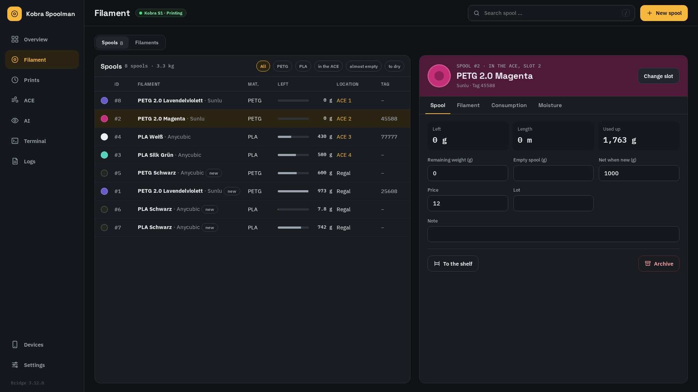 Regal: suchen, filtern, Spule bearbeiten, in einen Slot legen</td>
    <td align="center">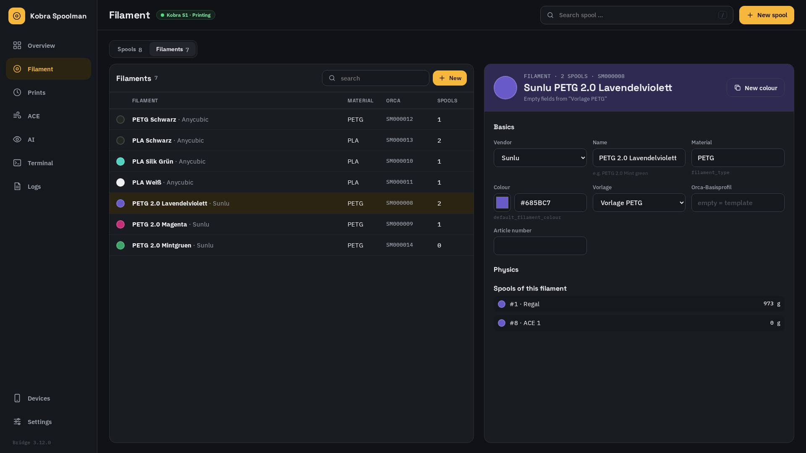 Filament-Editor: alle Orca-Werte, Vorlagenwerte als Platzhalter</td>
  </tr>
  <tr>
    <td align="center">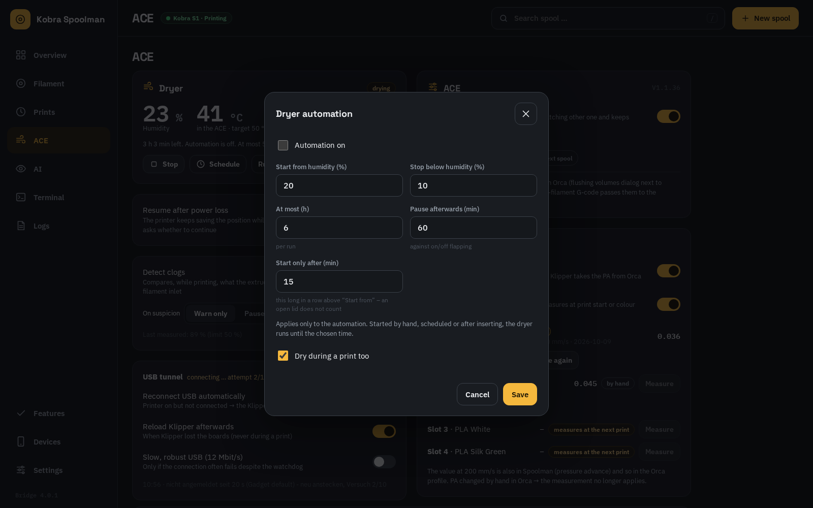 ACE-Trockner: Automatik nach Feuchte, nie heißer als die empfindlichste Spule</td>
    <td align="center">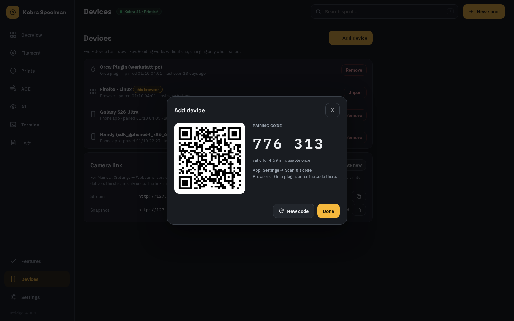 Geräte: ein Schlüssel pro Gerät, Koppeln per Code oder QR</td>
  </tr>
  <tr>
    <td align="center">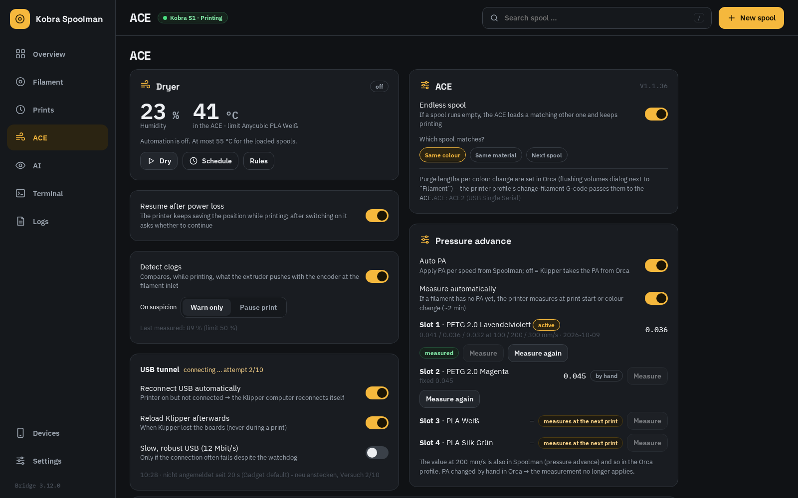 ACE: Trockner, Feuchte-Verlauf, Endlosspule, Temperaturgrenze</td>
    <td align="center">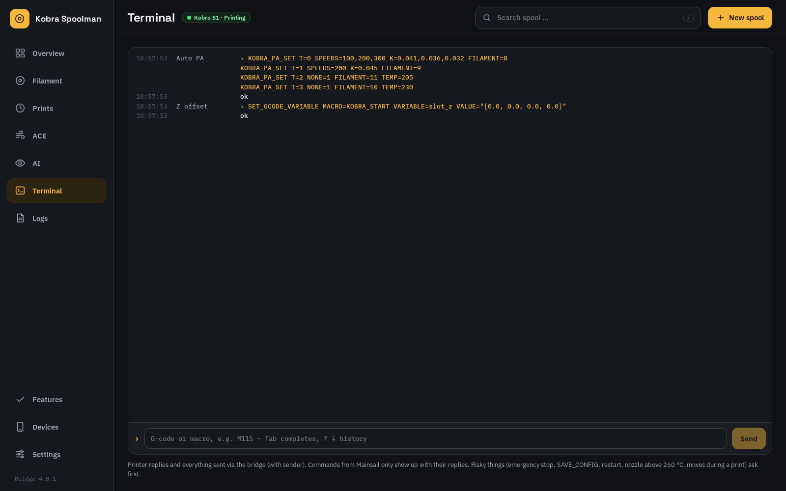 Terminal: Antworten des Druckers und jeder Befehl mit Absender, Riskantes fragt nach</td>
  </tr>
  <tr>
    <td align="center">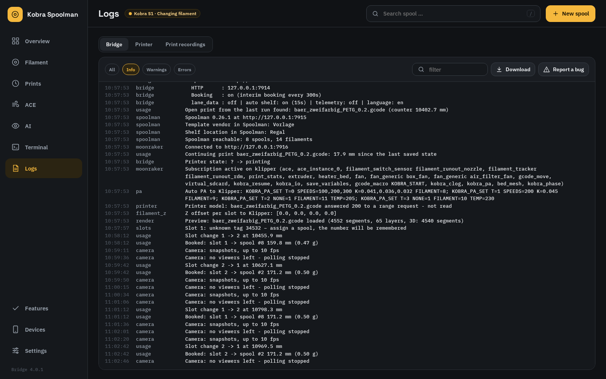 Logs: Bridge-Log, Logdateien des Druckers, Rohdaten jedes Drucks</td>
    <td align="center">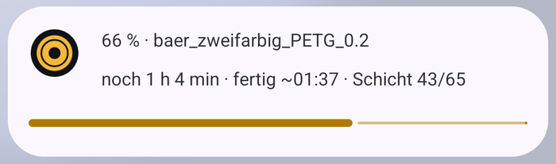 App: der laufende Druck in der Benachrichtigungsleiste</td>
  </tr>
  <tr>
    <td align="center" colspan="2">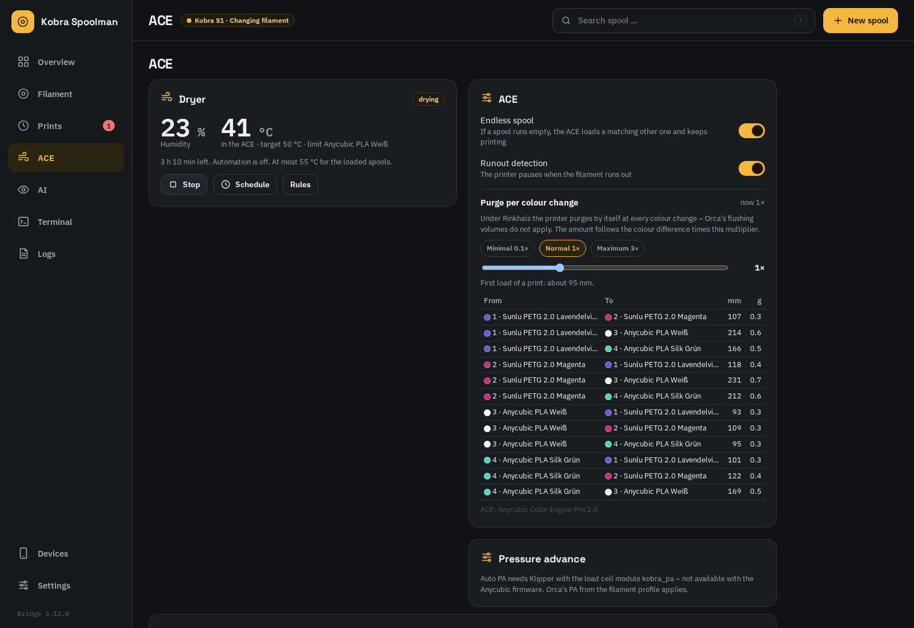 Rinkhals: Endlosspule, Auslauferkennung und Spül-Multiplikator der Firmware mit dem Spülen je Farbpaar (Bild englisch)</td>
  </tr>
</table>

Auf einem 5120×1440-Ultrawide passt die ganze Übersicht auf einen Bildschirm – Drucker mit großer Kamera, Slots, Trockner, ACE, Meldungen:

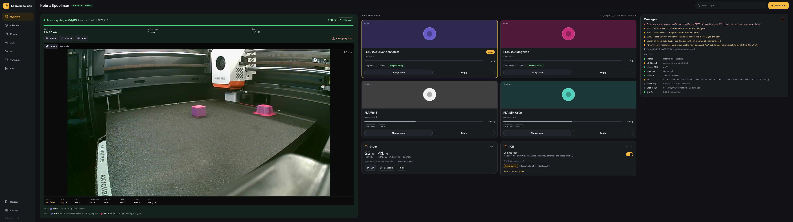

## Gemessene Genauigkeit

Ein echter Zweifarbdruck (4 Klingen weiß, Griff grün, ein Farbwechsel), gemessen mit Bridge 2.x auf der
Original-Firmware:

| | Slot 2 (weiß) | Slot 1 (grün) |
|---|---|---|
| Orca-Modelllänge | 2660 mm | 4830 mm |
| Gemessener Modellanteil | **2659 mm** | **4829 mm** |
| Spülen (Firmware) | 451 mm beim Start | 195 mm beim Wechsel |
| **In Spoolman gebucht** | **3055 mm ≈ 9,1 g** | **4970 mm ≈ 14,8 g** |

Die Summe stimmte exakt mit dem Zähler `filament_used` des Druckers überein – derselbe Druck läuft als Test der
aktuellen Bridge ([Test](tests/test_usage_rinkhals.py)). Unter Klipper bucht
die Bridge `print_stats.filament_used` auf den Slot, den ACEPRO als geladen meldet – beim Wechsel bekommt der
neue Slot das Laden bis zur Düse und das Spülen ([Test](tests/test_usage_acepro.py)). Mehr in [docs/findings.md](docs/findings.md) (englisch).

## Sicherheit

Lesen ist im Heimnetz offen. Alles, was etwas ändert – Spoolman, Slot-Zuordnung, offene Posten,
Trockner, Orca-Rücksync – braucht ein **gekoppeltes Gerät**: Die Bridge vergibt einen Schlüssel pro
Browser, Handy und Orca-Plugin, speichert nur dessen Hash und lässt dich Geräte jederzeit entfernen.
Die Bridge gehört ins Heimnetz; sie hat kein TLS.

## Dokumentation

| | |
|---|---|
| [Hier anfangen](docs/de/start.md) | Nach Zielen: der Kern in 5 Minuten, dann jede Erweiterung mit dem, was sie braucht, und wie man sie einschaltet |
| [Installation](docs/de/installation.md) | Spoolman, Bridge (Docker/Portainer), Koppeln, Orca-Build, Plugin, App |
| [Im Alltag](docs/de/usage.md) | Weboberfläche und App, Filamente, Slots, Drucken, Trockner, offene Posten, Rücksync |
| [Fehlersuche](docs/de/troubleshooting.md) | Häufige Probleme und Lösungen |
| [Spoolman-Felder](docs/spoolman-fields.md) | Welches Spoolman-Feld zu welcher Orca-Einstellung wird (englisch) |
| [Konfiguration](docs/configuration.md) | Alle Umgebungsvariablen der Bridge und Plugin-Einstellungen (englisch) |
| [API](docs/api.md) | HTTP-Schnittstelle der Bridge (englisch) |
| [Architektur](docs/architecture.md) | Datenfluss, Verbrauchsmessung, Profilauflösung, Koppeln (englisch) |
| [KI-Erkennung](docs/vision.md) | kobra-vision: wie Fehldrucke erkannt werden, Einrichtung, Bildersammlung, nächste Stufen (englisch) |
| [Android-App](docs/android-app.md) | Was die App kann, NFC-Tags, bauen (englisch) |
| [Befunde](docs/findings.md) | Was wir über die ACE, Rinkhals/GoKlipper, Klipper und Orcas Plugin-API gemessen haben (englisch) |
| [Changelog](CHANGELOG.md) | Versionsgeschichte (englisch) |

## Fahrplan

| Etappe | Inhalt | Stand |
|---|---|---|
| 1 | Moonraker- und Spoolman-Anbindung, Slot-Zuordnung, `lane_data`, Telemetrie | ✅ fertig |
| 2 | Verbrauch pro Spule, Journal, offene Posten, Soll-Abgleich, Historie | ✅ fertig |
| 3 | Orca-Profile aus Spoolman, Seitenpanel, Rücksync, gepatchter Orca-Build, Verbrauchsvorschau nach dem Slicen | ✅ fertig (Profile ohne Neustart nachladen ist zurückgestellt, siehe [Befunde](docs/findings.md)) |
| 4 | Weboberfläche, Android-App, Koppeln, ACE-Trockner, NFC-Tags, Spulen beim Einlegen am Tag erkennen | ✅ fertig |
| – | Klipper auf einem Raspberry Pi mit ACEPRO (Bridge 3.0); Spülen pro Farbwechsel aus Orcas Spülmengen | ✅ fertig |
| – | Druckermonitor (ersetzt OctoApp): Kamera-Restream, Drucksteuerung, Terminal, Logs, Benachrichtigungen aufs Handy | ✅ fertig (inkl. Widget, Prüfung beim Druckstart, 3D-Ansicht) |
| – | Filament-Automatik: Auto-PA pro Filament (Wiegezelle, je Geschwindigkeit), Z-Versatz pro Filament | ✅ fertig (3.1, 3.2) |
| – | Überwachung: Fortsetzen nach Stromausfall, Verstopfung erkennen, USB-Wächter | ✅ fertig (3.3, 3.4, 3.10) |
| – | Spülmengen je Farbpaar: jeden Wechsel protokollieren (3.10), dann die Menge ohne Farbreste lernen | ✅ Protokoll · 🔜 Lernen (braucht Rückmeldung je Druck) |
| – | KI-Fehldruck-Erkennung: Spaghetti (Stufe 1), Platte prüfen (2), umgefallene Teile (3) | ✅ Stufe 1 · 🔜 2 und 3 aus den gesammelten Bildern |
| – | Feuchte der Spulen: Feuchte-Verlauf der ACE, Trocknungs-Protokoll, Schätzung pro Spule, Trocknen beim Einlegen, Raumsensor | ✅ fertig |
| 5 | Home Assistant über MQTT (Drucker, Slots, Restgewicht, Feuchte, Meldungen), Raumsensor | ✅ fertig |
| – | Englisch als Hauptsprache, Deutsch je Nutzer und Gerät umschaltbar | ✅ fertig (3.12) |
| – | Rinkhals und Klipper in einer Bridge (Rinkhals: ACE-Karte mit Spül-Multiplikator, Spülen der Firmware in der Orca-Vorschau) | ✅ fertig (3.12) |
| – | Weboberfläche hinter Home-Assistant-Ingress ohne Patches (Community-Add-on) | ✅ fertig (3.13) |

## KI-Hinweis

kobra-spoolman ist mein Projekt ([@xNoVoSx](https://github.com/xNoVoSx)): Die Idee, was es kann, wie es funktioniert
und jede Entscheidung kommen von mir, und ich teste jede Änderung auf meinem eigenen Kobra S1 mit ACE 2 Pro, bevor sie
erscheint. Den Code schreibe ich zusammen mit einem KI-Programmierassistenten (Claude von Anthropic), der den Großteil
tippt – Code, Tests und Doku –, während ich steuere, prüfe und am Drucker ausprobiere.

Jede Änderung läuft durch die automatischen Tests, trotzdem kann so entstandener Code Fehler enthalten, die noch
niemand bemerkt hat. Die Software steuert echte Hardware (Heizungen, Motoren) – lies, was du installierst, behalte die
ersten Drucke im Blick und melde Auffälligkeiten als [Issue](https://github.com/xNoVoSx/kobra-spoolman/issues). Es gibt
keine Gewährleistung (siehe [Lizenz](LICENSE)).

## Dank

[OrcaSlicer](https://github.com/OrcaSlicer/OrcaSlicer) ·
[Spoolman](https://github.com/Donkie/Spoolman) ·
[Rinkhals](https://github.com/rinkhals-community/Rinkhals) ·
[ACEPRO](https://github.com/Kobra-S1/ACEPRO) und die Klipper-Projekte von [Kobra-S1](https://github.com/Kobra-S1) ·
Orca-PR [#14423](https://github.com/OrcaSlicer/OrcaSlicer/pull/14423) von Broncosis ·
[ACE-RFID](https://github.com/DnG-Crafts/ACE-RFID) ·
[SimplyPrints Notizen zum Anycubic-Tagformat](https://help.simplyprint.io/en/article/the-anycubic-material-standard-nfcrfid-for-the-anycubic-ace-js3oty/) ·
[Preact](https://preactjs.com/) + [htm](https://github.com/developit/htm) ·
[qrcode-generator](https://github.com/kazuhikoarase/qrcode-generator) ·
Schriften [Space Grotesk](https://github.com/floriankarsten/space-grotesk) und [IBM Plex](https://github.com/IBM/plex)

## Lizenz

[MIT](LICENSE). Mitgelieferte Fremddateien behalten ihre Lizenzen (`bridge/app/acebridge/static/licenses`, `android/licenses`).
[`vision/`](vision) (kobra-vision) steht unter AGPL-3.0, weil es Obicos Modell und Nachverarbeitung nutzt; die Bridge spricht nur per HTTP mit ihm.
Die OrcaSlicer-Patches liegen in [orca-kobra](https://github.com/xNoVoSx/orca-kobra) unter AGPL-3.0, wie OrcaSlicer selbst.
Kein offizielles Projekt von Anycubic, OrcaSlicer oder Spoolman.
