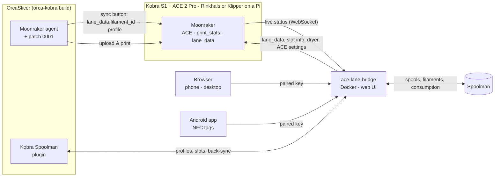

# kobra-spoolman

**Spoolman as the single source of truth for an Anycubic Kobra S1 with ACE 2 Pro — in OrcaSlicer, in the browser, on your phone and on the printer.**

Works on the **stock firmware with [Rinkhals](https://github.com/rinkhals-community/Rinkhals)** and on **Klipper on a Raspberry Pi** with ACEPRO — one bridge, it detects which one it talks to.

[Deutsch](README.de.md) · [Start here](docs/start.md) · [Installation](docs/installation.md) · [Daily use](docs/usage.md) · [Troubleshooting](docs/troubleshooting.md) · [API](docs/api.md) · [AI notice](#ai-notice)

---

You enter a filament **once** in [Spoolman](https://github.com/Donkie/Spoolman) — temperatures, fans,
aux fan, exhaust fan, flow, pressure advance, retraction. From then on:

- **OrcaSlicer** has a matching filament profile, created and kept up to date automatically, and
  one click on Orca's sync button puts the right profiles into the right ACE slots.
- Every print **books the consumption per spool** into Spoolman — measured on the printer,
  including load and purge, accurate to the millimetre.
- A **web UI** (phone, desktop, ultrawide) and an **Android app** show the printer, the four ACE
  slots and the shelf; you assign spools, create spools and filaments with all Orca settings and
  control the **ACE dryer** — without touching Spoolman's own UI.
- Changes you make to a profile in Orca are **written back to Spoolman** after you confirm.
- After slicing, the Orca panel shows **what each spool needs** for the plate and warns if one is too short.
- The bridge is also a **printer monitor that replaces OctoApp**: camera restream that spares the
  printer's CPU, **what the printer is doing right now** (*Preheating 5/15 min*, *Change to slot 2 · loading*,
  *Printing · layer 34/120*), pause/cancel/fine-tuning, terminal and logs, notifications on the phone — and
  spools with our NFC tags are **assigned to their slot by themselves** when loaded.
- An optional **AI** watches running prints and raises an alarm with a camera picture when a print
  turns into spaghetti — on the CPU, without any load on the printer ([vision.md](docs/vision.md)).
- The bridge **keeps track of how wet every spool is** — ACE humidity history, every drying, a
  moisture estimate per spool from where it was — dries spools by itself when they are loaded and
  checks at print start whether the loaded spools fit the file.
- **On Rinkhals** the ACE card shows and sets what the printer display hides: endless spool, runout detection and the
  firmware's **purge multiplier with a preview per colour pair**; the Orca usage preview adds the firmware's own purge.
- **On Klipper**, together with Klipper modules on the printer (not part of this repo), the filament data drives the
  print itself: **Auto PA** measured by the load cell and kept per filament, a **Z offset per
  filament**, **resume after a power loss** (probes the height on the part, always asks first) and
  **clog detection** (extruder vs. filament encoder) — each one with its own off switch.
- A view for the **printer's own touchscreen** (`/display`, 800×480): status, a print screen that opens by itself
  with the file's preview, and every switch — shown by a kiosk browser on the Klipper Pi.
- Live **3D view** of the running print in the spool colours, **Home Assistant** over MQTT, a
  **home-screen widget**, and every bridge setting changeable in the web UI.
- **English and German** in the web UI, app and Orca panel — every user and device picks its own language.

   
  Web UI: the printer monitor — camera and printer data, messages and status, dryer, ACE, the four slots

<table>
  <tr>
    <td align="center"> Web UI on the phone</td>
    <td align="center"> Android app</td>
    <td align="center"> Orca side panel</td>
  </tr>
</table>

## How it works

The bridge is the **only** client of this project on Moonraker and fans the data out: the browser, the
app, the Orca plugin and Home Assistant all talk to the bridge. It reads which firmware runs from Moonraker
(Rinkhals' `mmu`/`filament_hub` or ACEPRO's `ace`) and speaks to the ACE accordingly — nothing to configure.

| Component | What it does |
|---|---|
| **[ace-lane-bridge](bridge/)** (Docker) | Connects Moonraker and Spoolman. Web UI, slot ↔ spool assignment (automatic by NFC tag), writes `lane_data` for Orca, measures and books consumption per spool, open items, print history, ACE dryer automation and ACE settings (endless spool), humidity history and spool moisture estimate, print start check, camera restream, 3D print view, print control, terminal and logs, messages, runtime settings, Home Assistant via MQTT, device pairing, API for app and plugin, ships the app update. |
| **[Kobra Spoolman](orca-plugin/)** (Orca plugin) | One Orca filament profile per Spoolman filament (`SM000010` …), side panel with slots and profile check, usage preview after slicing, back-sync of profile edits to Spoolman. |
| **[Android app](android/)** | Printer with camera, 3D view and controls, notifications in the background, home-screen widget, slots, spool card, new spools and filaments, ACE dryer with humidity history and settings, spool moisture, writes ACE-compatible NFC tags (two per spool), pairing by QR code, updates through the bridge. |
| **[kobra-vision](vision/)** (Docker, optional, AGPL-3.0) | AI print-failure detection: Obico's failure model on ONNX Runtime (CPU, ~50 ms per picture), the bridge judges the results over time. |
| **[spoolman_setup.py](spoolman/)** | One-time setup of the Spoolman extra fields (all Orca filament settings) and material templates. |
| **[orca-kobra](https://github.com/xNoVoSx/orca-kobra)** (separate repo) | Nightly OrcaSlicer AppImage with four small patches: preset matching via `lane_data.filament_id` ([PR #14423](https://github.com/OrcaSlicer/OrcaSlicer/pull/14423)), read-only slice statistics for plugins, a minimum size for docked plugin panels and the real first-layer temperatures in the G-code header. Updates itself. |

## Requirements

You need **one** of the two printer setups:

| | **A — stock firmware + Rinkhals** (easiest) | **B — Klipper on a Raspberry Pi** |
|---|---|---|
| Printer | Kobra S1 + ACE 2 Pro, Anycubic firmware rooted with [Rinkhals](https://github.com/rinkhals-community/Rinkhals) | Kobra S1 + ACE 2 Pro, controllers tunnelled to a Pi ([vanilla-klipper-swu](https://github.com/Kobra-S1/vanilla-klipper-swu), [klipper-kobra-s1](https://github.com/Kobra-S1/klipper-kobra-s1)), ACE on the Pi with [ACEPRO](https://github.com/Kobra-S1/ACEPRO) |
| Moonraker | Rinkhals' Moonraker on the printer, port 7125 | Moonraker on the Pi, port 7125 |
| Extra hardware | none | Raspberry Pi, USB cables |
| Effort | install Rinkhals, done | a weekend |

Both need:

- **Spoolman** 0.26 or newer.
- A **Docker** host in the same network (Portainer, Compose, …) — or Home Assistant with the community
  [add-on](https://github.com/MineTech13/ha-addons) (web UI in the HA sidebar).
- **OrcaSlicer** with the plugin system (2.5.0-dev nightly). Automatic profile selection needs the
  `orca-kobra` build (Linux AppImage) until PR #14423 is merged upstream.
- Optional: an Android phone (Android 10+) with NFC for the app.

Other Rinkhals printers with an ACE (Kobra 3 and friends) use the same Rinkhals interface and should work, but are not
tested here — reports are welcome.

### What works on which setup

| Feature | A — Rinkhals | B — Klipper + ACEPRO |
|---|---|---|
| Orca profiles from Spoolman, side panel, back-sync, sync button | ✅ | ✅ |
| Consumption per spool booked in Spoolman | ✅ | ✅ |
| Web UI, Android app, notifications, widget, Home Assistant, NFC tags | ✅ | ✅ |
| ACE dryer with automation, humidity history, spool moisture | ✅ | ✅ |
| Endless spool | ✅ (on/off) | ✅ (on/off + matching mode) |
| Purge per colour change | firmware's own: multiplier + preview in the ACE card | Orca's flushing volumes |
| Usage preview in Orca | ✅ incl. the firmware purge | ✅ |
| Camera restream | ✅ (frame rate follows the printer's CPU) | ✅ |
| AI print-failure detection | ✅ | ✅ |
| Print phase (*Preheating*, *Change to slot 2* …) | basic (printing / changing) | ✅ detailed |
| Auto-PA, Z offset per filament, resume after power loss, clog detection | — (need Klipper modules) | ✅ with our Klipper modules (not part of this repo) |
| Printer touchscreen view (`/display`), USB watchdog, Klipper restart | — | ✅ |

## Quick start

**New here?** [docs/start.md](docs/start.md) starts with the core (Spoolman bookings in about 5 minutes) and lists
every extension with what it needs and what it costs the printer. The full workflow:

1. **Spoolman fields and templates** — once:
   `python3 spoolman/spoolman_setup.py --url http://<spoolman-host>:7912`
2. **Bridge** — add it to your Spoolman stack ([compose example](bridge/compose.yaml)) with
   `MOONRAKER_URL=http://<printer-ip>:7125` (Rinkhals) or `http://<pi-ip>:7125` (Klipper).
3. **Pair your browser** — open `http://<docker-host>:7913` and enter the setup code from the
   bridge log (`Setup code: …`). Further devices get a code under *Devices → Add device*.
4. **OrcaSlicer** — install the self-updating build from [orca-kobra](https://github.com/xNoVoSx/orca-kobra) (`tools/install.sh`).
5. **Plugin** — copy [`kobra_spoolman.py`](orca-plugin/kobra_spoolman.py) to
   `~/.config/OrcaSlicer/orca_plugins/kobra_spoolman/`, enable it, set the bridge address and
   enter a pairing code in its panel. Restart Orca once — your Spoolman filaments are now Orca profiles.

Full guide: **[docs/installation.md](docs/installation.md)**.

## Daily use

1. New filament → create it in the web UI or the app (or in Spoolman): template or Orca base
   profile, plus whatever you want to override.
2. Load the spool → with our NFC tags it is assigned to its slot by itself; otherwise assign it in
   the web UI or the app (spools that match what the ACE reports come first). Spools without a tag get
   their material and colour passed to the printer display.
3. In Orca press the filament **sync** button → the `SM…` profiles land in slots 1–4.
4. Print → consumption is booked per spool, visible live in the web UI and in Spoolman.
5. Tweak a profile in Orca and save → confirm → the change is stored in Spoolman.

Details: **[docs/usage.md](docs/usage.md)**.

## Screens

<table>
  <tr>
    <td align="center"> Shelf: search, filters, edit a spool, move it to a slot</td>
    <td align="center"> Filament editor: every Orca setting, template values as placeholders</td>
  </tr>
  <tr>
    <td align="center"> ACE dryer: automation by humidity, never hotter than the most sensitive spool</td>
    <td align="center"> Devices: one key per device, pairing by code or QR</td>
  </tr>
  <tr>
    <td align="center"> ACE: dryer, humidity history, endless spool, temperature limit</td>
    <td align="center"> Terminal: printer answers and every command with its sender, risky ones ask first</td>
  </tr>
  <tr>
    <td align="center"> Logs: bridge log, the printer's log files, raw print recordings</td>
    <td align="center"> App: the running print in the notification bar</td>
  </tr>
  <tr>
    <td align="center" colspan="2"> Rinkhals: endless spool, runout detection and the firmware's purge multiplier with the purge per colour pair</td>
  </tr>
</table>

On a 5120×1440 ultrawide the whole overview fits on one screen — printer with a large camera, slots, dryer, ACE, messages:

## Measured accuracy

A real two-colour print (4 blades white, handle green, one colour change), measured with bridge 2.x on
the stock firmware:

| | Slot 2 (white) | Slot 1 (green) |
|---|---|---|
| Orca model length | 2660 mm | 4830 mm |
| Measured model part | **2659 mm** | **4829 mm** |
| Purge (firmware) | 451 mm at start | 195 mm at the change |
| **Booked in Spoolman** | **3055 mm ≈ 9.1 g** | **4970 mm ≈ 14.8 g** |

The sum matched the printer's `filament_used` counter exactly — the same print is replayed as a test of the current
bridge ([test](tests/test_usage_rinkhals.py)). Under Klipper the bridge books
`print_stats.filament_used` to the slot ACEPRO reports as loaded — during a change the incoming slot gets
the load to the nozzle and the purge ([test](tests/test_usage_acepro.py)). More in [docs/findings.md](docs/findings.md).

## Security

Reading is open in your network. Everything that changes something — Spoolman, slot assignment,
open items, the dryer, Orca back-sync — needs a **paired device**: the bridge issues one key per
browser, phone and Orca plugin, stores only its hash and lets you remove devices at any time.
Keep the bridge inside your home network; it has no TLS.

## Documentation

| | |
|---|---|
| [Start here](docs/start.md) | By goal: the core in 5 minutes, then every extension with what it needs and how to switch it on |
| [Installation](docs/installation.md) | Spoolman, bridge (Docker/Portainer), pairing, Orca build, plugin, app |
| [Daily use](docs/usage.md) | Web UI and app, filaments, slots, printing, dryer, open items, back-sync |
| [Troubleshooting](docs/troubleshooting.md) | Common problems and how to solve them |
| [Spoolman fields](docs/spoolman-fields.md) | Which Spoolman field becomes which Orca setting |
| [Configuration](docs/configuration.md) | All bridge environment variables and plugin settings |
| [API](docs/api.md) | HTTP API of the bridge |
| [Architecture](docs/architecture.md) | Data flow, consumption algorithm, profile resolution, pairing, design decisions |
| [AI detection](docs/vision.md) | kobra-vision: how failures are detected, setup, data collection, next stages |
| [Android app](docs/android-app.md) | What the app does, NFC tags, building it |
| [Findings](docs/findings.md) | What we measured and learned about the ACE, Rinkhals/GoKlipper, Klipper and Orca's plugin API |
| [Changelog](CHANGELOG.md) | Version history |

## Roadmap

| Stage | Content | Status |
|---|---|---|
| 1 | Moonraker + Spoolman connection, slot assignment, `lane_data`, telemetry | ✅ done |
| 2 | Consumption per spool, journal, open items, target comparison, history | ✅ done |
| 3 | Orca profiles from Spoolman, side panel, back-sync, patched Orca build, usage preview after slicing | ✅ done (reloading profiles without a restart is deferred, see [findings](docs/findings.md)) |
| 4 | Web UI, Android app, pairing, ACE dryer, NFC tags, spools recognised by their tag when loaded | ✅ done |
| — | Klipper on a Raspberry Pi with ACEPRO (bridge 3.0); purge per colour change from Orca's flushing volumes | ✅ done |
| — | Printer monitor (replaces OctoApp): camera restream, print control, terminal, logs, phone notifications | ✅ done (incl. home-screen widget, print start check, 3D view) |
| — | Filament automation: Auto-PA per filament (load cell, per speed), Z offset per filament | ✅ done (3.1, 3.2) |
| — | Monitoring: resume after a power loss, clog detection, USB tunnel watchdog | ✅ done (3.3, 3.4, 3.10) |
| — | Purge volumes per colour pair: log every change (3.10), then learn the volume without colour residue | ✅ log · 🔜 learning (needs feedback per print) |
| — | AI print-failure detection: spaghetti (stage 1), plate check (2), knocked-over parts (3) | ✅ stage 1 · 🔜 2 and 3 from the collected pictures |
| — | Spool moisture: ACE humidity history, drying log, estimate per spool, automatic drying when loaded, room sensor | ✅ done |
| 5 | Home Assistant via MQTT (printer, slots, remaining weight, moisture, messages), room humidity sensor | ✅ done |
| — | English as main language, German switchable per user and device | ✅ done (3.12) |
| — | Rinkhals and Klipper in one bridge (Rinkhals: ACE card with purge multiplier, firmware purge in the Orca preview) | ✅ done (3.12) |
| — | Web UI behind Home Assistant ingress without patches (community add-on) | ✅ done (3.13) |

## AI notice

kobra-spoolman is my project ([@xNoVoSx](https://github.com/xNoVoSx)): the idea, what it does, how it works and every
decision come from me, and I test each change on my own Kobra S1 with ACE 2 Pro before it is released. I write the
code together with an AI coding assistant (Anthropic's Claude), which does most of the typing — code, tests and
documentation — while I steer, review and try it out on the printer.

Every change goes through the automated tests, but code written this way can still contain mistakes nobody has noticed
yet. It controls real hardware (heaters, motors) — read what you install, watch your first prints, and report anything
odd as an [issue](https://github.com/xNoVoSx/kobra-spoolman/issues). The software comes without any warranty (see the
[licence](LICENSE)).

## Credits

[OrcaSlicer](https://github.com/OrcaSlicer/OrcaSlicer) ·
[Spoolman](https://github.com/Donkie/Spoolman) ·
[Rinkhals](https://github.com/rinkhals-community/Rinkhals) ·
[ACEPRO](https://github.com/Kobra-S1/ACEPRO) and the [Kobra-S1](https://github.com/Kobra-S1) Klipper projects ·
Orca PR [#14423](https://github.com/OrcaSlicer/OrcaSlicer/pull/14423) by Broncosis ·
[ACE-RFID](https://github.com/DnG-Crafts/ACE-RFID) ·
[SimplyPrint's notes on the Anycubic tag format](https://help.simplyprint.io/en/article/the-anycubic-material-standard-nfcrfid-for-the-anycubic-ace-js3oty/) ·
[Preact](https://preactjs.com/) + [htm](https://github.com/developit/htm) ·
[qrcode-generator](https://github.com/kazuhikoarase/qrcode-generator) ·
fonts [Space Grotesk](https://github.com/floriankarsten/space-grotesk) and [IBM Plex](https://github.com/IBM/plex)

## License

[MIT](LICENSE). Bundled third-party files keep their licences (`bridge/app/acebridge/static/licenses`, `android/licenses`).
[`vision/`](vision) (kobra-vision) is AGPL-3.0, because it runs Obico's model and post-processing; the bridge talks to it over HTTP only.
The OrcaSlicer patches live in [orca-kobra](https://github.com/xNoVoSx/orca-kobra) under AGPL-3.0, like OrcaSlicer itself.
Not affiliated with Anycubic, OrcaSlicer or Spoolman.
