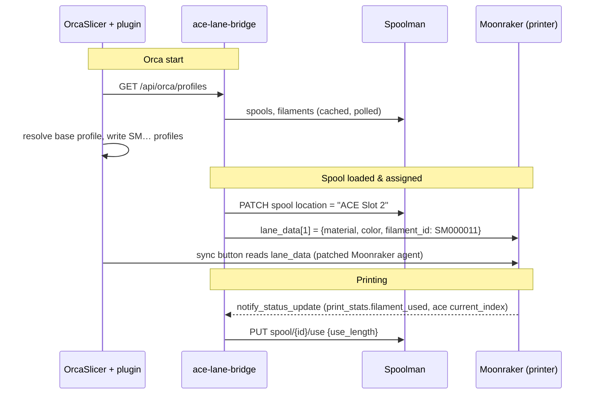

# Architecture

[Back to README](../README.md)

## Principles

1. **Spoolman is the single source of truth** for everything about filament: properties, Orca
   settings, remaining weight and where a spool is (`ACE Slot N` or the shelf).
2. **No firmware patches.** The bridge only talks to Moonraker and Spoolman over their public APIs — Moonraker of
   the stock firmware with Rinkhals, or of Klipper on a Raspberry Pi with the ACEPRO driver. The ACE keeps working on
   its own (endless spool, RFID).
3. **Measure, don't estimate.** Consumption comes from the printer's extrusion counter.
4. **Nothing is lost silently.** Unbookable consumption becomes an open item; the bridge survives
   restarts mid-print.
5. **One code base for both firmwares.** Everything that depends on the firmware sits behind one module
   (`acemodel.py`); the rest of the bridge does not know which one runs.
6. **English first.** Code, comments, logs, API and docs are English; user-facing texts go through a catalog and can
   be German per user and device (see [Languages](#languages)).

## Components and data flow

## Two firmwares (`acemodel.py`, `moonraker.py`)

The bridge finds out what it talks to from Moonraker itself — no setting:

| | Klipper + ACEPRO | Rinkhals (GoKlipper) |
|---|---|---|
| Detected by | Moonraker objects `ace` / `ace_instance_0` | objects `mmu` (Rinkhals' `mmu_ace.py`) / `filament_hub` (GoKlipper); `Moonraker.platform` = `rinkhals` when Moonraker lists the components `kobra` or `mmu_ace` |
| Subscription | base objects + every optional object `printer.objects.list` reports | base objects + `mmu`, `filament_hub` + only listed optional objects — subscribing to an object GoKlipper does not have can make it panic |
| Slots | `ace_instance_0.slots[i]` | `mmu.gate_*` lists; tag = `filament_hub` slot `rfid == 2` |
| Loaded slot | `ace.current_index`, `ace.target_index` during a change | `mmu.gate` / `gate_status` (flickers during a change → debounced, `GATE_DEBOUNCE_S`), `mmu.ttg_map` for tool → slot |
| Slot info for untagged spools | `ACE_SET_SLOT T= MATERIAL= COLOR= TEMP=` | `MMU_GATE_MAP MAP="{gate: {...}}"` (refused for tagged slots) |
| Dryer | `ACE_START_DRYING` / `ACE_STOP_DRYING`, durations in seconds | `MMU_DRYER_START UNIT=0 DURATION=<min> TEMP=` / `MMU_DRYER_STOP`, duration in minutes |
| ACE settings | endless spool + mode (G-code) | `filament_hub/get_config`/`set_config` (`auto_refill`, `runout_detect`), `SET_ACE_FLUSH_MULTIPLIER` |
| Purge per colour change | Orca's flushing volumes (`ACE_SET_PURGE_AMOUNT`, `EXTERNAL_PURGE`) | the firmware's own: `purge.py` predicts it |
| Klipper restart | `FIRMWARE_RESTART` | refused (Rinkhals blocks it) |

`acemodel` turns both into one view (`slot()`, `active_slot()`, `dryer()`, `endless_spool()`, `changing()`,
`tool_slot()`) and builds the commands (`set_slot_command`, `dryer_start_command`, …). Features that need our Klipper
modules (Auto-PA, Z offset, resume, clog detection, print phase, USB watchdog) look for their objects and stay hidden
when they are missing — on Rinkhals they simply never appear.

### Firmware purge (`purge.py`, Rinkhals)

For prints started through Moonraker the stock firmware ignores the slicer's flush matrix and purges by itself:
colour volume = clamp(Orca's colour formula(from, to) + `flush_volume_min`, min, max), purge = volume ×
`flush_multiplier` / 2.405 + offset (mm), plus a fixed first load (~95 mm). `flush_volume_min/max` and the multiplier
come from GoKlipper's configuration; offset and first load are fitted (least squares) from finished Orca prints, where
"measured − G-code target" per slot is exactly the firmware's purge. The ACE card shows the result per colour pair
(`/api/ace`), the Orca plugin adds it to its usage preview (`/api/orca/state` → `purge.model`).

## Home Assistant ingress (`ingress.py`)

The web UI only uses relative paths (a test checks it), so it works under HA's ingress base path
`/api/hassio_ingress/<token>/` unchanged. When a request really comes through the ingress proxy (header `X-Ingress-Path`
and source address `172.30.32.2`, as HA's add-on docs prescribe), the start page carries `<meta name="ingress">`: the
camera then asks for one image after the other (`frame.jpg?after=n`, a long poll on the camera's newest frame) because
the MJPEG stream does not pass every proxy chain, and links for other programs (camera links, app pairing) point at the
bridge's direct address. Optionally (`HA_INGRESS_TRUST`) such requests count as a paired device; the header alone never
does, anyone in the network could send it to the direct port.

## Languages

- **Source text is English** everywhere; German lives in catalogs: bridge `locale/de.json` (`tr()` in `i18n.py`), web
  `static/i18n/de.json` (`t()` in `i18n.js`), app `assets/i18n/de.json` (`tr()` in `data/I18n.kt`, plus Android
  resources for the manifest and the widget), plugin `DE` dict at the end of `kobra_spoolman.py`.
- The language is chosen per request (`?lang=`, `X-Lang`, `Accept-Language`, else `UI_LANGUAGE`): the bridge renders
  answer texts lazily, so one bridge serves an English browser and a German phone at the same time. Logs are always
  English.
- Stable codes never change with the language: states, sources (`hand`, `plan`, `spule`, …), Spoolman extra-field
  keys (`orca_basis`, `vorlage`, …). Some of them are German for historical reasons and stay, because stored data and
  older apps use them.
- Spoolman names (shelf location, template vendor, field names) are English for a new install; an existing install
  with the German names (`Regal`, `Vorlage`) keeps them — the bridge detects which one exists.
- Tests (`tests/test_i18n*.py`) fail on a German word in a source string and on a catalog key the code no longer uses.

## Clients and pairing (`bridge/app/acebridge/auth.py`)

The bridge is the only component of this project that talks to the printer — the printer (Rinkhals on
the Kobra's small CPU, or the Pi) should serve only a few Moonraker clients. Browser, Android app and Orca plugin are clients of the bridge.

- **Reading is open**, like Moonraker and Spoolman in a home network.
- **Writing needs a paired device:** Spoolman changes, slot assignment, open items, the dryer and
  Orca back-sync. The client sends `Authorization: Bearer <key>`.
- The **bridge issues the keys** (`secrets.token_urlsafe(32)`), one per device, and stores only
  their SHA-256 in `devices.json`. A device is paired with a 6-digit code (5 minutes, single use)
  that a paired device requests; the very first device uses a setup code that the bridge logs at
  start while nothing is paired. Wrong codes are throttled. The app pairs by scanning a QR code
  (`kobraspoolman://pair?b=<bridge-url>&c=<code>`).
- Removing a device revokes its key immediately; a client that gets 401 drops its key and asks to
  pair again. A legacy `APP_TOKEN` keeps working as a key and pairing code during the transition.
- **Camera key:** camera images are private too (paired devices only), but Mainsail and an ``
  tag cannot send a header. A separate, view-only key (`camera.json`) is accepted as `?key=` on the
  camera URLs; any paired device can show or replace it.

## Features (`bridge/app/acebridge/features.py`)

One list of everything the system can do, built on the switches that already exist — nothing is switched twice:
runtime settings (`runtime_settings.py`), printer module switches (`switches.py`), what the installation sets
(environment variables, read only) and paired clients (`auth.py`). `view()` gives each feature its state (available,
on, switchable, source, why), `switch()` sends the change where the switch lives. A setting whose environment variable
is set explicitly counts as set by the installation, so the HA add-on keeps control over its options. Every feature
links to its heading in `docs/usage.md` / `docs/de/usage.md` (a test checks the anchors).

## First start (`bridge/app/acebridge/setup.py`)

Decided once, at the first start of a version that has it, before any other part writes to DATA_DIR: a DATA_DIR with
paired devices, bookings or saved settings is an existing installation — every switch stays, web and app show a
one-time hint on the Features page. An empty one is new: the comfort features that act on their own
(`NEW_DEFAULTS`: automatic drying, drying new spools, print recordings) start off unless the installation sets them,
and the web UI opens the setup page after pairing until it is done. Stored in `DATA_DIR/setup.json`.

## Messages and status (`bridge/app/acebridge/status.py`)

Computed on every `/api/app/state` from what the bridge already holds — no extra request to the
printer. The print file parsed for the preview (`render.py`) also records the net extrusion per tool
(retractions cancel out) with a checkpoint every 256 KB and at every tool change, plus the list of
tool changes. From the current `file_position` the bridge gets what each tool still prints and which
changes are still to come; each change adds the load to the nozzle (85 mm) and the purge the file sets
before it (`ACE_SET_PURGE_AMOUNT PURGELENGTH=`, from Orca's flushing volumes; 50 mm without). Tool T*n* is
slot *n*+1; compared with the assigned spool's remaining weight, this gives "spool won't last". The same
parse gives the per-slot G-code targets for the check at the end of a print.

## Camera restream (`bridge/app/acebridge/camera.py`)

The camera still runs on the printer (its own mjpg-streamer); its address comes from Moonraker's webcam
list. Under the stock firmware a single MJPEG stream took the whole printer CPU, while single snapshots up
to ~5 per second cost nothing measurable ([findings](findings.md#camera-load-on-the-kobra-s1-2026-10-01)).
The bridge therefore fetches snapshots one after another by default (`CAMERA_STREAM=false`) — only while
someone watches, closed 20 s after the last viewer — and fans each frame out: web UI, app, Mainsail
(camera link) and the AI service. Each viewer always gets the newest frame; a slow viewer skips frames
instead of queueing. Wherever the bridge knows the printer's own CPU (`printercpu.py`) it starts at 2 fps and
follows it, averaged over 10 s: under Rinkhals from Moonraker's `proc_stats` (Moonraker runs on the printer), with
Klipper on a Pi from the printer's own Moonraker (Rinkhals keeps it running beside the USB tunnel; `/machine/proc_stats`
every 3 s, address `PRINTER_CPU_URL` or the camera's host on port 7125). On 19.10. a continuous stream took the printer
CPU to 100 % with Klipper on the Pi too: mjpg-streamer and the tunnel still run on the printer. Without a known printer
CPU (camera on the Klipper computer) the rate is simply `CAMERA_FPS_MAX`. Below
`CAMERA_CPU_LOW` it adds 1 fps every 5 s, above `CAMERA_CPU_HIGH` it takes one away (`/api/camera` → `throttled`, the
web UI shows *throttled*). *Status* shows the Klipper CPU and, beside a separate Klipper, the printer CPU; the printer
card (web, app), the display (*System → Info*) and Home Assistant (`printer_cpu`) show it all the time
(`printer.printer_cpu`). `CAMERA_STREAM` is ignored wherever the printer CPU is known — on 13.10. (Rinkhals) and 19.10.
(tunnel) a stream kept the printer CPU at 100 % — and every change of it ends the running reader, so it takes effect
while people watch.

## AI print-failure detection (`vision.py`, `vision/`)

A separate container (kobra-vision, AGPL-3.0, Obico's failure model on ONNX Runtime) does the image
recognition; the bridge sends it one picture every 10 s while printing (newest restream frame or one
single snapshot — it never starts the camera pump for this), judges the result over time like Obico
(EWM against a baseline, safe start, warn/fail thresholds), raises messages, stores frames and labels.
Details: [vision.md](vision.md).

## Klipper modules on the printer (`pa.py`, `filament_z.py`, `resume.py`, `clog.py`, `phase.py`, `startseq.py`, `direct.py`, `nozzle.py`, `spare.py`)

Since 3.0 the printer runs real Klipper, so features that need the printer's timing live in Klipper modules
(kept in a separate, private repo, not part of this one). The bridge is their link to Spoolman and to the
UIs: it subscribes to their status objects (optional — a missing module only hides its card), turns them
into messages and cards, and switches them through G-code commands. Every module stores its own on/off
switch in the printer (`save_variables`), so it also works without the bridge.

Klipper runs API G-code only when no other command is running — during the print start (`G9111` is one macro) that
can be many minutes. So the syncs (`pa.py`, `filament_z.py`) go through `gcodepush.py`: at most one request in flight
with a long deadline, never resent while Klipper is busy (before 3.11.1 every 15 s timeout resent it and dozens piled
up in Klipper, with a PAUSE queued behind them).

Status from Moonraker is processed in its own task (`Moonraker._dispatch`), not in the WebSocket reader: merging into
the cache and `on_status` run there one update at a time, in order, so a handler may call Moonraker itself and the
reader still delivers the answer (before 3.11.1 such a call waited 15 s for an answer nobody read, and the bridge
processed nothing meanwhile).

Pause and cancel during the print start: the printer module `kobra_seq` runs the start in steps and waits
interruptibly; it takes requests on its own Klipper endpoint `kobra_seq/control`, which Moonraker forwards as
`printer.kobra_seq.control` and which bypasses the G-code lock. While `kobra_seq.active`, `Moonraker.action` sends every
`printer.print.pause/resume/cancel` there (`startseq.route`) — for the web UI, app, display and the automatic pauses alike.
`appapi.printer_state` reports a paused start sequence as `paused` (Klipper still says printing: the start macro is
running) and adds `start_seq` (`paused`, `requested`, `step`); the booking logic keeps reading Klipper's own state.

| Bridge | Klipper object | Direction |
|---|---|---|
| `pa.py` | `kobra_pa` (+ `kobra_nozzle`) | Spoolman `pa_table` (one table per nozzle) → `KOBRA_PA_SET` per slot for the nozzle in use; measured result → back to the filament (`pa_table` entry of that nozzle, `pressure_advance`) |
| `filament_z.py` | `KOBRA_START` variable `slot_z` | Spoolman `z_offset` (or the template's) of each loaded slot → printer; the print start applies the start filament's value |
| `resume.py` | `kobra_resume` | interrupted print → alarm + card; *Resume* sends `KOBRA_RESUME CONFIRM=1` only after confirmation |
| `switches.py` | all of them | one list of the modules' switches for display, web and app (`/api/switches`); sends only listed commands |
| `machine.py` | toolhead, T0–T3, ACEPRO | display control: home, jog, extrude, load/unload, fixed macros — fixed commands with limits, locked while printing |
| `files.py`, `prompts.py` | Moonraker files, `action:prompt_*` | display: print files with slot check and start; macro prompts (buttons send only the G-code the macro gave them) |
| `clog.py` | `kobra_clog` | `suspect` → alarm until the filament moves normally again; switch and reaction (`warn`/`pause`) |
| `phase.py` | `kobra_phase` (+ `kobra_pa`, `ace`, console) | print phase text for web, app, display and MQTT (`printer.phase`); read only |
| `startseq.py` | `kobra_seq` | print start running: pause/resume/cancel → `printer.kobra_seq.control`; paused start → state `paused` + `start_seq` for the UIs |
| `direct.py` | `kobra_direct` | direct feed on/off with the spool inserted; booking, Auto PA and Z offset take that spool for every tool; red bar |
| `nozzle.py` | `kobra_nozzle` | swappable hotends: hotend in use, print start check, Z correction (`KOBRA_NOZZLE`), PID measurement in the background (`KOBRA_NOZZLE_PID`); nozzle → `pa.py`, files without `G9111 NOZZLE=` → `printcheck.py` (Orca's `; nozzle_diameter` from `render.py`) |
| `spare.py` | `kobra_spare` | empty spool without a matching one: the question with the Spoolman spools, the choice (`KOBRA_SPARE T=`, in the background; display prompt buttons too), red message `spare` → phone alarm, switches `spare`/`spare_auto` |
| `usb.py` | Moonraker database `kobra_usb` (USB watchdog service on the Klipper computer) | state every 30 s → status line, message after giving up; switches written to `kobra_usb.switches` |

Writes to the printer wait until Spoolman is loaded (`sm.connected`), so a fresh start never sends empty slots.

## HTTP API (`web.py`, `api_*.py`, `appapi.py`)

`web.build_app` creates the aiohttp app (CORS, health, slots, spools) and lets each area add its routes:
`api_modules` (dryer, Auto-PA, resume, switches incl. USB watchdog and purge log, clog, ACE), `api_display`
(machine control, printer files, macro prompts, system), `api_camera` (camera, print preview), `api_data` (moisture,
settings, consumption, recordings), `api_vision` (AI), `api_orca` (Orca plugin), `api_control` (print control,
console, logs); `appapi.py` is the Android app's API. Shared helpers (`need_device`, `paired`, camera access, JSON body)
live in `webcommon.Ctx`. Every state file in `DATA_DIR` is written through `storage.save_json`/`save_lines`
(temporary file, fsync, rename — never half a file).

## Web UI (`bridge/app/acebridge/static/`)

- Served by the bridge itself at `/`; no build step: [Preact](https://preactjs.com/) with
  [htm](https://github.com/developit/htm) tagged templates as ES modules, fonts as WOFF2 and a QR
  encoder are bundled — the page works without internet.
- It uses the same API as the app (`/api/app/*`, `/api/slots`, `/api/dryer`, `/api/jobs`,
  `/api/auth/*`) and polls `/api/app/state` every 3 s (only the bridge, never the printer).
- One code base for all widths: phone (bottom bar), desktop (side bar, list + detail), ultrawide
  ≥ 3000 px (five columns on the overview). Design tokens match the Android app's theme.
- The key lives in `localStorage` of the browser.
- **No stale UI after an update** (`assets.py`): at start the bridge fingerprints all files in
  `static/`. The start page is never cached and loads everything from `assets/<fingerprint>/…`,
  which is cached for a year — new files mean new addresses. `/api/app/state` reports the
  fingerprint as `ui`; an open page with an older one reloads itself (not while a dialog or an editor
  is open or you are typing).

## Consumption algorithm (`bridge/app/acebridge/usage.py`)

- `print_stats.filament_used` counts every extruder move — the print, and ACEPRO's load to the nozzle
  and purge at a tool change (ACEPRO patch: `gcode_move.reset_last_position()` after its direct
  extruder moves, so they show up at once).
- Consumption = **signed** delta of `filament_used`; retracts cancel out.
- Each delta belongs to the slot the ACE reports as loaded (ACEPRO `ace.current_index`, Rinkhals
  `filament_hub.current_filament` once it stayed the same for `GATE_DEBOUNCE_S`; while it is empty, to the slot
  before); during a tool change after the unload (`current_index = -1`) to the incoming
  slot (`ace.target_index`). So the unload
  retract goes to the old filament, load and purge to the **newly loaded** one — which is physically right.
  Consumption before the first loaded slot goes to the first one.
- Buckets are *(slot, spool)*: if the spool in a slot changes mid-print, both get their share; with
  endless spool the consumption simply follows the new slot.
- Bookings: `PUT /api/v1/spool/{id}/use` with `use_length` (Spoolman converts using density and
  diameter). At every slot change, every `BOOK_INTERVAL_S` and at the end. Interim bookings only go forward:
  GoKlipper drops its counter by 53 mm at every unload (retract and cut) and counts 50 mm back before the next slot,
  so a negative amount waits. At a change and at the end a correction takes back at most what the print booked on
  that spool; a net retract on a slot that hardly printed is dropped, not an open item (replay
  `tests/test_replay_rinkhals.py`, 56 changes).
- State (`data/usage/state.json`) is written atomically right after every successful booking, so a
  crash cannot book twice; on restart the bridge continues from the saved counter.
- Target comparison: once the bridge has parsed the print file (`render.py`) it stores the extrusion per
  tool as the job's targets; at the end a slot that measured clearly less than its target is reported.

## Orca profiles

- The bridge computes, per filament with an active spool, the values that come from Spoolman
  (filament → template → overrides) — `GET /api/orca/profiles`.
- The plugin resolves the **Orca base profile** from Orca's own system profile JSONs
  (`<data dir>/system`, `$APPDIR/resources/profiles`, or wherever Orca says the preset lives),
  merges the inheritance chain, applies the Spoolman values and writes a **user base profile**
  (`inherits: ""`, `filament_id: SM…`) to `user/<folder>/filament/base/`. Only base profiles keep a
  custom `filament_id`; inherited user presets would take the parent's ID.
- Profiles written by the plugin carry a marker in `filament_notes`; only those are ever updated or deleted.
- Orca reads profiles at start-up only → new or changed profiles need a restart.
- Back-sync: on Orca's `PresetSaved` event the plugin diffs the saved file against what it wrote,
  asks, and posts the changes to `/api/orca/backsync`.

## Why no custom printer agent?

The first proof of concept was a Python printer agent that reported the slots itself. It proved
that Orca picks custom profiles by `filament_id`, but printing through a Python agent is not
practical today: Orca's plugin sandbox has no file access to the temporary print file, so every
print would trigger a permission prompt (on a worker thread). Instead, the built-in Moonraker agent
does the printing, and a 70-line patch ([PR #14423](https://github.com/OrcaSlicer/OrcaSlicer/pull/14423))
makes it match presets by `lane_data.filament_id` — which the bridge already writes.

## Usage preview after slicing

On `SlicingJobComplete` (and on every panel refresh) the plugin reads
`orca.host.slice_statistics()` — per filament the model, support, prime tower, flush and total
volume plus density and the filament changes (`transitions`: from → to with
counts). `build_forecast()` converts them to grams exactly like Orca's preview legend (*Total* =
model + support + flush + tower; Orca's own `total_volumes_per_extruder` attributes the tower
differently at tool changes and is not used) and compares that with the spool's remaining weight.
Filament N is counted against slot N.

**ACE purge per colour change (Klipper + ACEPRO):** the printer profile's change-filament G-code sets the purge from Orca's
flushing volumes (`ACE_SET_PURGE_AMOUNT`) and reports load + purge to Orca with `; EXTERNAL_PURGE <mm>`
after the `T` line, so Orca counts it as *Flushed* on the new filament — Orca's legend and the preview
show the real consumption without a model of their own. If a print changes colour but reports no purge
at all, the panel says the printer profile is outdated. When the plate's slice result becomes invalid
the preview is hidden. Without patch 0003 the attribute is missing and the preview is simply not shown
(feature detection, no version check).

**Firmware purge (Rinkhals):** Orca's matrix does not reach the stock firmware, so *Flushed* is 0. When
`/api/orca/state` carries `purge.model`, `build_forecast()` adds the firmware purge per filament (column *Firmware
purge*): with Orca's `transitions` exactly per change (first load for `from = null`, else the colour formula between
the slot colours); without them it spreads the first load over the filaments and uses the mean of the changes from the
others. It also flags a slot whose material is empty at the printer — GoKlipper cancels such a print.

## Threads in the plugin

Network and file work run in one background thread; Orca preset objects are only touched on the UI
thread (panel messages, events). Dialogs and dock panels are thread-safe in Orca's plugin API.
