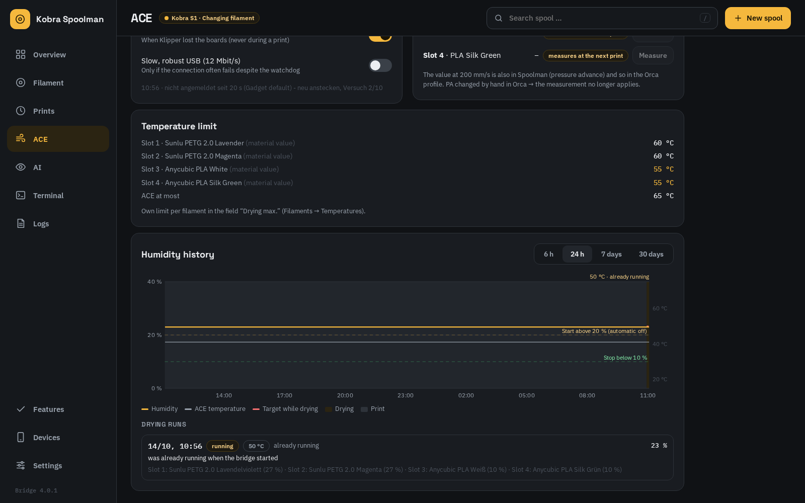
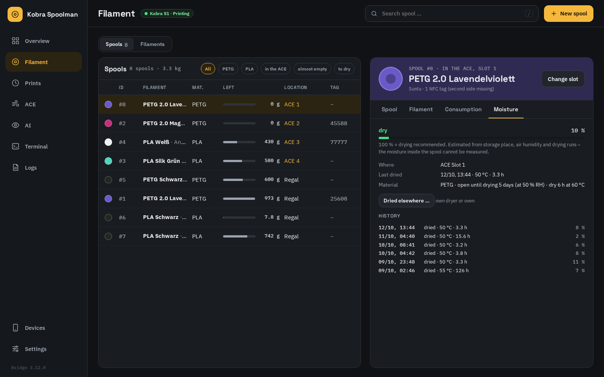
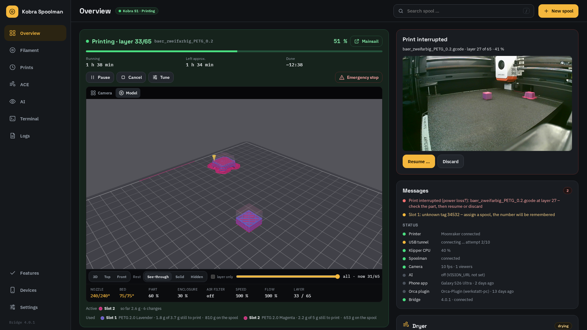
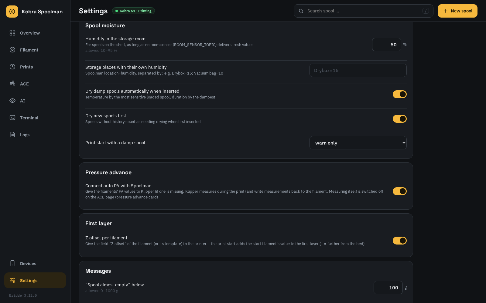
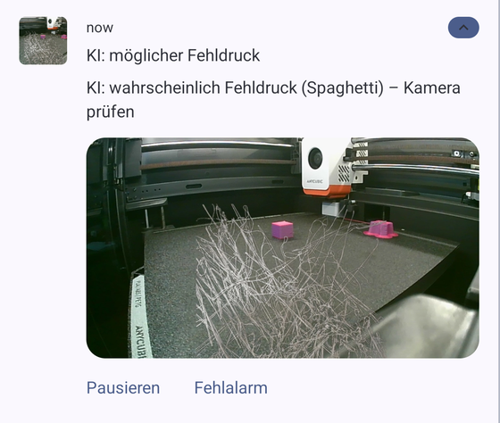

# Daily use

[Deutsch](de/usage.md) · [Back to README](../README.md)

## Web UI and app

Everything you do at the printer goes through the **web UI** (`http://<docker-host>:7913`) or the
**Android app**. Both show the same data from the bridge; the app can additionally read and write
NFC tags. Spoolman's own UI is only needed for things the bridge does not cover (e.g. editing a vendor).

| Screen width | Layout |
|---|---|
| Phone | bar at the bottom: *Overview*, *Filament*, *Prints*, *More* |
| Desktop | side bar on the left: *Overview*, *Filament* (spools and filament types), *Prints*, *ACE*, *Terminal*, *Logs*, devices, settings |
| Ultrawide (≥ 3000 px, e.g. 5120×1440) | the overview fits on one screen: printer with a large camera, slots with dryer and ACE, messages and status |

The **overview** is the printer monitor: the camera (the model only while printing), print status,
printer data, **Messages** and the four slots with dryer and ACE settings. Managing spools, filament
types and the print history has its own pages.

**Messages** lists, most important first, what needs attention: printer paused or in error, a slot
without material at the printer, a spool that **won't last for the running print** (the bridge reads
the print file: what each tool still prints plus the purge of the colour changes still to come,
5 % reserve), a spool almost empty (< 100 g), bookings not yet in Spoolman, Spoolman unreachable,
high humidity with the automation off, a print that just finished. Below it, **Status**: printer,
Spoolman, camera (frame rate, viewers), the paired app and Orca plugin (last seen) and the bridge.

Keyboard (desktop): `/` search, `n` new spool, `↑` `↓` select a spool, `Esc` close.
Right-click on a spool → put it into a slot, back on the shelf, archive.

The web UI asks for pairing once per browser ([installation](installation.md#4-pair-your-first-device)).
*View only* skips it — everything is visible, but buttons that change something lead to the pairing screen.

## A new filament arrives

Create it in the web UI under **Filaments → New**, in the app with **New → Not there? New filament**, or in
Spoolman directly.

| Field | What to enter |
|---|---|
| Vendor, Name | e.g. *Sunlu*, *PETG 2.0 Lavender* — the name includes the colour |
| Material | `PLA`, `PETG`, `PLA Silk` … (the base type decides the Orca filament type) |
| Colour | hex colour; for Anycubic spools use what the ACE reports so the slot check matches |
| Density, diameter, weight, price | from the label / shop |
| **Template** *or* **Orca base profile** | see below |
| Everything else | only what you want to override — empty fields show the inherited value as a grey placeholder |

**Template or base profile?**

- **Template** (`Vorlage PETG`, …): generic starting values maintained in Spoolman. Good for most
  third-party filaments. Leave empty → the template is picked by material.
- **Orca base profile**: the exact name of an Orca system profile, e.g.
  `Anycubic PLA Silk @Anycubic Kobra S1 0.4 nozzle`. The editor offers the names the Orca plugin
  reported. Use it when Orca already ships a tuned profile — the template is then ignored completely.

Order of precedence (later wins): *Orca base profile* ← *template* ← *filament fields* ← *Orca overrides*.
If neither the filament nor its template names a base profile, `Generic <material> @System` is used
(e.g. `Generic PLA @System` for PLA+). The name is matched ignoring case and an optional `@System`
(`eSun PLA+` finds `eSUN PLA+ @System`).
Field reference: [spoolman-fields.md](spoolman-fields.md).

**Same product, another colour:** open the filament and press **New colour** — all values are copied,
you only enter name and colour.

The Orca plugin creates the profile `Vendor Name (SM0000xx)` the next time Orca starts. Already
running? Press **Update profiles** in the panel, then restart Orca. Orca's filament **sync**
button then puts the profiles into the filament slots (see below).

## A new spool

**New spool** (top right, or `n`): pick the filament, check the weights (defaults come from the
filament), optionally **Insert right away** into a slot. In the app you can also scan an NFC tag first
— the new spool is linked to it, or the app writes an ACE-compatible tag for it
([android-app.md](android-app.md)). Spools that only carry a **Spoolman label** (e.g. stocked refills): in the
app's scan sheet *Scan a QR code instead* opens the spool from its Spoolman QR code — put it into a slot and write
its tags from there; the tag of an old spool body moves to it and the app offers to archive the old spool.

## Loading a spool into the ACE

On the slot card press **Change spool** (or **Assign spool** for an empty slot) and pick the
spool. Spools that match what the ACE reads from the tag are on top and marked *matches*.

**Spools without a tag:** the ACE does not know their material. When you assign such a spool, the
bridge passes material, colour and temperature from Spoolman to the ACE driver (`ACE_SET_SLOT`; assigned
before loading: as soon as the spool is in; during a print: afterwards). Only the assignment does
this; to push the values again, assign the spool again. ACEPRO needs them for endless spool and for the
load temperature.

Removing a spool: if the ACE reports a slot empty for a while, the spool is moved to the shelf
automatically (during a print only after it ends). You can also press **Empty** on the slot card.
When the printer or the ACE is switched off, every slot looks empty at once — then nothing is moved: the spools stay
in their slots, and the slot cards show them dimmed with *Offline – last known* until the ACE reports again.

**Spools with our tags are assigned automatically.** When the ACE reads one of our stickers
(`AHPEBK-<number>`, number ≥ 1000) in a slot, the bridge assigns the spool with that tag number — the
previous spool goes to the shelf, also during a print (consumption continues on the new spool). A
spool already loaded when the bridge starts is recognised too. The slot card then says *RFID*.
An unknown number shows up under *Messages*; assign the spool by hand once and the bridge remembers
the number on it (if it has none yet). Original Anycubic tags (102, 107, …) name a filament type, not a
spool: the bridge assigns the spool on the shelf with the same material, colour and vendor — but only if
exactly one fits; with several it asks under *Messages* (switch: *Settings → Slots and RFID*,
`AUTO_ASSIGN_BY_KIND`). A manual assignment is not overridden until the tag in the slot changes.

## Spools and filament types

**Filament** has two views, switched at the top: **Spools** (spools) and **Filaments** (filament types).
A filament type lists its spools; tapping one opens it under *Spools*.

**Spools** lists every active spool with remaining weight, location and tag number; filter by material,
*in the ACE* or *almost empty* (< 200 g), or search. Select a spool to edit it:

- **Spool**: remaining weight (after weighing), empty spool weight, net weight, price, lot, note and —
  for spools on the shelf — the storage location.
- **Filament**: the filament editor, right there.
- **Consumption**: first and last use and every recorded print with this spool.

## Drying (ACE dryer)

The dryer card shows the ACE's humidity and its current temperature; while drying also the set point,
the filament that limits it and the time left. **Dry** /
**Stop** works by hand; **Rules** sets the automation: start when the humidity rises above a
threshold (default 20 %) — and has stayed above it for *Warten* minutes (default 15), so opening
the lid for a moment starts nothing — stop below a second one (default 10 %) or after a maximum time,
then a pause; optionally also while printing. A run started **by hand, by plan or because a spool was
loaded** always lasts its full time, however dry the ACE reports; if the ACE stops early, the bridge
starts it again with the remaining time. Only the automation stops on low humidity.

**Lid open, heater fault.** Closed, the ACE 2 Pro is at ~52 °C after 18 minutes; with the lid open it
stays far below (44 instead of 60 °C on our test). If the ACE is still more than 10 °C below its target 30 minutes
into a run, web and app say *lid open?* (the app as a notification) and the run keeps the minutes it was too
cold. If the ACE reports a **dryer fault** (e.g. `PTC_err`, heater), the bridge stops: no restart, no automation,
no planned start — a red message asks you to look at the ACE; starting by hand still works. Switch:
*Settings → Spool moisture* (`DRYER_LID_CHECK`).

The temperature is **never higher than the most sensitive loaded filament allows** — the field
*Dry max.* on the filament, else on its template, else a cautious default per material
(PLA 55 °C, PETG 60 °C, TPU 55 °C, …) — and never higher than the ACE can do (ACE 2 Pro 65 °C, ACE Pro 55 °C).
If a more sensitive spool is loaded while drying, the bridge lowers the temperature at once and keeps
the remaining time. The **ACE** page lists the limit of every slot.

**Humidity history** (ACE page, in the app in the dryer sheet) shows the ACE humidity over 6 h to
30 days, the ACE temperature, the set point while drying, the automation thresholds as dashed lines
and every print and drying as a band. Below it every drying with who started it (automation, by hand,
planned, spool loaded, printer display/Mainsail) and why, its temperatures and the humidity before and after.
A run that did not really dry (lid open, fault) can be **discarded** there: its spools go back to the moisture
estimate from before it, also in Spoolman.

## Spool moisture

Nobody can measure how wet a spool is — but the bridge can follow where it was. Every spool gets a
**moisture estimate**: it rises with the humidity around the spool (ACE sensor while loaded, the
storage room on the shelf) and falls while drying — towards the humidity the ACE measures while drying, so a
run with the lid open (ACE at 40 %) hardly counts (switch `MOISTURE_ACE_RH`). 100 % means *drying recommended*. How fast a
material takes up water and how long it needs to dry come from the material (open at 50 % RH: PLA ~14 days,
PETG ~5, ABS/ASA ~21, TPU ~2, PA/PVA less) and can be set per filament (*Open until drying*,
*Dry duration*).

- **Loading a spool that needs drying** — also a new spool without history — starts the ACE dryer by
  itself: temperature of the most sensitive loaded spool, time of the wettest one.
- **Print start check**: when a print starts, the bridge compares every tool of the file with its
  slot — empty slot, other material, clearly different colour, no spool assigned, or a spool that
  needs drying — and shows it under *Messages*. By default it only warns; *Print start with a damp
  spool → pause the print at once* pauses the print once instead.
- The spool card has a **Humidity** tab with the estimate, where the spool is, the last drying and its
  history; **Dried elsewhere …** records drying in another dryer. The spool list can filter
  *to dry*.
- The storage room counts with 50 % humidity until a **room sensor** is connected through MQTT (see
  [configuration](configuration.md#home-assistant-mqtt)); dry boxes get their own value per Spoolman
  location (`Trockenbox=15`).

## Watching a print in 3D

While printing, **Model** shows the print file in 3D like OrcaSlicer's preview — grey background, the
Kobra S1 plate with its 10 mm grid, every line as a lit strand with its real width and layer height in
the colours of the loaded spools: printed part solid, the rest as you choose under *Rest* — *See-through*,
*Solid* (the whole model in full colour, like Orca) or *Hidden* — and the nozzle position live. Below the picture,
*Used* lists the slots the file uses with the total amount and what is still to print, purge included. Drag to rotate, two fingers or right mouse button
to move, wheel or pinch to zoom; *3D*, *Top*, *Front* jump to a view. The layer slider looks at any
layer (*layer only* shows only that one, *Live* returns to the running layer). How it is drawn depends on
the device (*Settings → This device → 3D model*, in the app *Settings → 3D model*):
*Volume* (shaded strands), *Lines* (light on the graphics), *Bridge image* (for weak devices)
or *Automatic*, which picks by what the device can do.

## Watching a print

Instead of just *Printing*, the printer card, the app, the display and Home Assistant say **what the printer is doing**:
*Heating bed 63/100 °C*, *Heat soak 5/15 min*, *Wiping nozzle*, *Cooling nozzle for probing*, *Probing Z*, *Measuring bed mesh*,
*Heating nozzle*, *Change to slot 2 · loading* (heats, unloads, loads, purges), *Purging*, *Measuring pressure advance*,
*Prime line*, then *Printing · layer 34/120*. The steps of the print start come from the printer's Klipper module
`kobra_phase` (it can be switched off there); without it — and on Rinkhals — the card still shows tool changes and the
layer.

The printer card shows **Model** — the print file drawn by the bridge in the colours of your
loaded spools, printed part solid, the rest as a shadow, with the current layer — and **Camera**,
the printer camera live (only on paired devices), with the frame rate in the corner. Below the image:
nozzle and bed (actual/target), part, enclosure and air filter fans, speed and flow factor, layer —
values with a target or a changed factor are highlighted. Tap the image for full screen. Below the
progress bar: how long the print has been running, about how long it still takes and the estimated
finish time (*~17:35*, *tomorrow ~02:10*), estimated from the progress so far.

The bridge **restreams** the camera: however many browsers and phones watch, it fetches single images
from the printer only once — and only while someone is watching. The rate (up to 10 fps) adapts to the
printer's CPU; *throttled* in the corner means the bridge is holding back so the print comes first. The
printer card (and the display under *System → Info*) shows the printer's own CPU all the time — under Rinkhals and
with Klipper on a Pi beside it (read from the Moonraker Rinkhals keeps running on the printer) — and there the bridge
never opens the camera's continuous stream (it took the whole printer CPU, with the USB tunnel too). The *continuous
stream* setting only applies where the printer CPU is unknown (camera on the Klipper computer); switching it takes
effect at once. Point Mainsail at the bridge too, so it does not open
a second stream: **Devices → Camera link** shows a stream and a snapshot URL. In Mainsail open
*Settings → Webcams*, edit the webcam, choose the service *MJPEG-Streamer* and paste the two URLs.
The link only shows the camera; *Create new* replaces it (the old one stops working).

## ACE settings

The **ACE** page (app: tap the dryer card) shows what the printer display hides:

- **Endless spool** — when a spool runs out, the ACE loads a matching one and the print goes on. On Klipper +
  ACEPRO *Which spool matches?* picks same colour and material, same material, or simply the next spool; on Rinkhals the
  firmware decides. Allowed while printing; applies at the next runout. The consumption follows the new slot. No match:
  see [When a filament is used up](#when-a-filament-is-used-up).
- **Runout detection** (Rinkhals) — the printer pauses when the filament runs out.
- **Schedule drying** — one start at a set time, e.g. tonight at 22:00.
- **Pressure advance**, **Resume after power loss** and **Detect clogs** (Klipper) — the switches of
  the printer's Klipper modules, see the sections below. Each card only shows when the printer has the
  module; every switch is stored in the printer.

**Purge per colour change** depends on the firmware:

- **Klipper + ACEPRO:** set in Orca (flushing volumes next to *Filament*); the printer profile's change-filament
  G-code passes it to the ACE driver, see [installation](installation.md#orca-printer-profile).
- **Rinkhals:** the Anycubic firmware purges by itself and ignores Orca's matrix. The amount follows the colour
  difference (Orca's own colour formula) times the firmware's **purge multiplier**. The ACE card shows the multiplier
  with the presets *Minimal 0.1×*, *Normal 1×* and *Maximum 3×* and a slider, and below it a table with the purge in mm
  and g for every pair of loaded colours — move the slider to see what another multiplier would cost, then
  *Apply*. During a print the card asks first; the printer uses the new value from the next colour change. The first
  load of a print is a fixed amount (about 95 mm). The bridge learns its model from finished Orca prints
  ([findings](findings.md)).

## Resume after a power loss

*Klipper only — needs a Klipper module on the printer (not part of this repo); not available on Rinkhals.*

With the Klipper module `kobra_resume` (not part of this repo) the printer keeps saving the position it has really
printed. After a power loss the overview shows **Print interrupted** with the live picture (and the app raises an
alarm): check that the part is still stuck to the bed, then **Resume** — the printer heats the bed, homes X/Y,
probes the height on the last printed line with the load cell (instead of homing Z onto the part), purges and continues
where it stopped, slower for the first minute. If the probed height does not fit it stops instead of guessing.
**Discard** drops it. Nothing happens without your confirmation. Switch: ACE page → *Resume after power loss*.

## Clog detection

*Klipper only — needs a Klipper module on the printer (not part of this repo); not available on Rinkhals.*

With the Klipper module `kobra_clog` (not part of this repo) the printer compares, while printing, how much filament
the extruder fed with what the encoder at the filament inlet saw. If the encoder sees far too little twice in a row,
the overview and the app show **Clog?** with the numbers — check the nozzle and the filament path. ACE page →
*Detect clogs* switches it off and sets the reaction: *Log only* (only the printer's log, the module's default),
*Warn only* or *Pause print*. Tool changes are not checked (the ACE moves the filament itself), nor is direct feed.

## Direct feed (filament straight into the toolhead)

*Klipper only — needs the Klipper module `kobra_direct` on the printer (not part of this repo).*

For filament that should not go through the ACE — TPU, for example — you insert it by hand straight into the
toolhead. **ACE page → Direct feed → Switch on …** (app: ACE sheet, also on the printer display) asks which spool you
insert, and whether the ACE filament still in the head should be unloaded first (the head heats up over the waste
chute). Then insert the filament into the toolhead.

While it is on:

- a **red bar** on every page (web, app home screen, printer display, Mainsail) — it stays on until you switch it off,
  also after a restart;
- the print start loads nothing from the ACE, primes briefly and refuses to start without filament at the toolhead
  sensor; the toolhead sensor pauses when the filament runs out;
- the consumption is booked on the chosen spool (no open item), Auto PA and the Z offset come from its filament;
- the ACE stays on: drying, humidity and slots work as usual;
- a file that uses more than one filament is paused at once with a message — multi-colour only works through the ACE.

In Orca nothing changes: pick the profile of the inserted filament in any slot. **Switch off** (red bar, ACE page or
display) returns to printing through the ACE; not possible during a print.

## Swappable hotends

*Klipper only — needs the Klipper module `kobra_nozzle` on the printer (not part of this repo).*

For printers with several hotends — e.g. the 0.2/0.4/0.6 ceramic hotends for the Kobra S1 next to the original. Klipper
has one PID for the nozzle; a different hotend (another heater) needs its own. The card **Hotend** on the ACE page (app:
ACE sheet, printer display: *Control → Hotend*) lists the hotends; after a swap, tap the one you put in — Klipper takes
its PID, nozzle size and Z correction at once, without a restart (not during a print).

- **Measure PID** — once per hotend: the printer homes if needed, moves over the waste chute and heats the nozzle several
  times (a few minutes). The values apply at once and stay with that hotend. A hotend that was never measured heats with
  the PID of the Klipper configuration (the original's) and shows a warning.
- **Z correction** of the hotend (web) — added to the first-layer offset, like the Z offset per filament.
- **Check the nozzle at print start** — a file sliced for another nozzle is stopped: with our Orca profiles (they pass
  the nozzle to the start G-code) before anything heats up, other files (Orca's `; nozzle_diameter` comment) are paused
  at once with a message.
- **Auto PA** keeps its values per nozzle (see [pressure advance](#pressure-advance-auto-pa)).

In Orca, use a printer profile with the right nozzle (0.2 and 0.6 printer and process profiles come with the Klipper
modules). *Features → Swappable hotends* switches it all off: Klipper heats with its configuration again.

## Z offset per filament

*Klipper only — needs a Klipper module on the printer (not part of this repo); not available on Rinkhals.*

Some filaments want the first layer a little higher or lower (e.g. PETG). Enter it in Spoolman as **Z offset** (mm,
+ = farther from the bed) on the filament or on its template; the bridge gives the values of the loaded slots to the
printer and the print start adds the start filament's value to the first layer (shown in the console as
`Filament T0 +0.020`). Empty = 0. Off: *Settings → First layer*, or `use_filament_z: False` in `KOBRA_START`.

## Pressure advance (Auto-PA)

*Klipper only — needs a Klipper module on the printer (not part of this repo); not available on Rinkhals.*

With the Klipper module `kobra_pa` (not part of this repo) the printer measures pressure advance with the load cell
in the print head, like Anycubic's stock firmware, but only once per filament: if the filament of a slot has no PA in
Spoolman yet, the printer measures it at the start of the print or after the colour change (~2 minutes, about 120 mm
into the purge chute) and the bridge stores the result on the filament — a table with K per speed (*PA table (auto PA)*) and K
at 200 mm/s in *Pressure advance*, which Orca's profile picks up. Klipper then applies K per move speed.

The card **Pressure advance** on the ACE page (app: ACE sheet) shows K per slot and has two switches that live in the
printer: **Auto PA** (off = Klipper uses Orca's PA) and **Measure automatically**. *Measure* measures the loaded slot now
(not while printing), *Measure again* deletes the value so the next print measures again. A value you enter by hand
(Spoolman or Orca) counts as fixed PA and is not measured; changing PA in Orca replaces a measured table. A failed
measurement never stops the print — it continues with the previous PA. *Settings → Pressure advance* turns off the
link to Spoolman entirely.

With [swappable hotends](#swappable-hotends) the PA is kept **per nozzle**: the card shows the nozzle in use, after a
hotend change a filament without values for that nozzle is measured at the next print, and *Measure again* deletes
only the values of the nozzle in use.

## Slicing and printing

1. In Orca press the filament **sync** button. With the orca-kobra build the `SM…` profiles are
   selected for slots 1–4 automatically; the panel shows *Filament N in Orca: matches* per slot and
   warns if a filament box does not match its slot.
2. Slice. At the top of the panel, **Planned usage** (planned usage) shows one line per slot:
   *need / remaining g* and ✓ (enough), ⚠ (*tight*, tight) or ✗ (*not enough*, too short). If a
   spool is too short, Orca also shows a warning. *Details* expands the breakdown (below).
3. Print as usual (printer agent *Moonraker*).
4. During the print the printer card and the slot cards show the consumption so far
   (*this print*). The bridge books into Spoolman at every colour change, every 5 minutes and at
   the end. Finished prints appear under **Prints** with grams per spool.

Pause, cancel and fine-tuning work from the printer card ([below](#controlling-a-print)); files,
macros and starting a print stay in Mainsail/Fluidd (*Mainsail* on the printer card).

### How the usage preview is calculated

The *Details* table is Orca's own preview legend (Preview → Filament), all values in grams.

| Column | Source |
|---|---|
| *Model*, *Support*, *Flushed*, *Tower*, *Total* | model, support, flush and prime tower per filament, *Total* is their sum; empty columns are left out, as in Orca. Klipper + ACEPRO: *Flushed* contains the ACE's load (85 mm) and purge at every colour change — the printer profile reports it to Orca (`EXTERNAL_PURGE`). If it is missing although the print changes colour, the panel says so. |
| *Firmware purge* | Rinkhals only: what the firmware purges by itself per filament — the first load plus every colour change into it, from the slot colours and the bridge's purge model (the same numbers as the ACE card). It counts into *Total* and into the need per slot. |
| *Rest* | remaining weight of the spool assigned to the slot, from Spoolman |

Filament N in Orca is counted against slot N — the same mapping the sync button sets. The
preview needs the orca-kobra build (patch 0003); it disappears when the slice result is no longer
valid (model or settings changed).

On Rinkhals the panel also flags a loaded slot **without material** at the printer — the firmware would cancel the
print. Assign a spool (the bridge then tells the ACE its material) or set it on the printer display.

## Open items

If a slot without an assigned spool was used (or a print without the ACE and without
[direct feed](#direct-feed-filament-straight-into-the-toolhead)), or its spool was deleted, the consumption is kept as
an **open item** (card *Open bookings*, badge on *Prints*). Press **Book**, pick the spool, or
**Discard**. If Spoolman was unreachable, bookings are retried automatically.

## Changing a profile in Orca

Edit an `SM…` profile and save it. The plugin asks *Write it to Spoolman?*:

- **Yes** — known settings go to their Spoolman fields, everything else to *Orca overrides*.
- **No** — the next sync resets the profile to the Spoolman values (Spoolman stays the source of truth).

This needs the plugin to be paired; otherwise it tells you so. To go back to the template for a
single value, clear that field in the filament editor (or use `POST /api/orca/reset`, see [api.md](api.md)).

## When a filament is used up

**No matching spool loaded** (Klipper + ACEPRO with the printer module `kobra_spare`, endless spool on): instead of
only pausing, the print waits over the waste chute and asks which loaded spool to continue with — a card on the
overview (web and app, with the Spoolman spool, colour and weight left), the printer display, a Mainsail prompt and a
red message (alarm on the phone). One tap changes to that slot and the print goes on; if the file calls the empty tool
again later (multi-colour), it takes the same replacement until the print ends. Another material asks first: the
nozzle switches to the temperature of the new spool, the bed and the fans stay as the file sets them, and pairs that
usually do not stick (e.g. PLA on PETG) are marked red. *Slot n refilled – load and continue* takes the same slot once
you have put a new spool in. *Features*: **Ask for another spool** on/off and **Without an answer** — keep waiting
(default) or take the most similar spool after 5/15/30 minutes. Without the module, ACEPRO only pauses as before.

**Archive** on the spool (shelf, app or Spoolman). Filaments without any active spool lose their
Orca profile on the next sync; profiles the plugin did not create are never touched.

## Controlling a print

Below the print status (web UI and app, paired devices only): **Pause** / **Resume**, **Cancel**
(asks first, a cancelled print cannot be resumed), **Tune** — speed, flow, the three fans and
the nozzle/bed target, also without a print (e.g. to preheat) — and **Emergency stop**: hold it for two
seconds, then confirm. After an emergency stop (or a Klipper error) the bar shows **Reload Klipper**
(`FIRMWARE_RESTART`, asks first); home the axes again afterwards.

**During the print start** (Klipper + ACEPRO with the printer module `kobra_seq`) Pause and Cancel work too: the start
sequence holds at the next safe point — before its next step or while it waits for a temperature or the heat soak —
and lifts the nozzle; the status says *Start sequence paused*, **Resume** continues there. Cancel switches the heaters
off at once and ends the print as cancelled. Steps without a waiting point (filament change, PA measurement, bed mesh)
finish first — the card says *pauses after this step*. After 30 minutes paused it cancels by itself. This works from
the web UI, the app, the display and for the automatic pauses (AI, damp spool, clog); Mainsail and KlipperScreen still
wait until the start is done. Without the module, or with Rinkhals, everything stays as before (only the emergency stop
helps during the start).

## The printer's own display

`http://<docker-host>:7913/display` is a view made for the Kobra S1's touchscreen (800×480, fingers): a kiosk
browser on the Klipper Pi shows it on the original display (setup outside this repo; Klipper only — on Rinkhals the
printer keeps Anycubic's own screen). Left bar: *Home*, *Print*,
*Files*, *Control*, *Switches*, *System*; the light button sits top right next to the clock. The top-left corner
is left empty on purpose: the printer's viewer app swallows touches there (hold 5 s to leave the viewer).

- **Home** — nozzle, bed, ACE humidity, the four slots with their spool colour and weight, the dryer.
- **Print** — opens by itself when a print starts: the file's preview picture, progress, layer, running/remaining/
  finish time, temperatures, speed and flow, the slots the file uses; pause/resume, *Tune* (speed, flow),
  cancel (asks first).
- **Switches** — every switch of the printer's Klipper modules in tabs (*Printing*, *Monitoring*, *Light & sounds*,
  *System*), plus the AI. They are stored in the printer, so web UI, app and Mainsail show the same. *System* holds the
  *Diagnostic log* and the three switches of the USB tunnel watchdog (see below).
- **Control** — temperatures (presets from the loaded spools or the number pad), moving (home, jog with 0.1–50 mm
  steps, motors off), filament (load a slot through the ACE, unload, extrude when hot, *eject* a slot = pull the filament out of the
  ACE so the spool can come off – also on the web slot card and the app's spool card), fans, *Measure bed meshes*,
  Klipper restart and an emergency stop you hold for 1.5 s. Moving and loading are locked while printing.
- **Files** — the print files on the printer with preview, time and colours; tap one to see its tools next to the
  slots and start it. After a print: *Erneut drucken*.
- **Tune** (while printing) — speed and flow, the first layer's height (±0.01–0.05 mm, *Apply for …*
  adds it to the filament's *Z offset* in Spoolman) and *Objects* to skip a failed part.
- **System** — all messages, IP and versions, the USB tunnel's state with its last event, Klipper restart, Pi
  reboot/shutdown. Macro prompts (e.g. filament runout) and a Klipper error appear over everything; the Klipper error
  screen also says what the USB tunnel is doing.

**USB tunnel watchdog.** The printer and the Klipper computer talk over a USB cable; after switching the printer off and
on, that connection sometimes does not come up. A watchdog service on the Klipper computer (set up outside this repo)
then reconnects by itself and reloads Klipper. The bridge shows its state (status line *USB tunnel*: connected, printer
off, connecting … attempt n, or an error message after giving up) and its switches: *Reconnect USB automatically*,
*Reload Klipper afterwards*, *Slow, robust USB* (12 Mbit/s, only if the connection still fails often) — on the display
under *Switches → System*, in the web UI as the card *USB tunnel* on the *ACE* page, in the app in the ACE window.
- Pause has no confirmation; *Cancel* appears once paused and asks first; the emergency stop always asks first.
- After a power loss the whole screen asks whether to resume ([see above](#resume-after-a-power-loss)).

Reading needs no key; to switch something the display is paired once like any device: create a code under
*Devices → Add device* and type it on the display's number pad.

## Notifications on the phone

The app watches the printer in the background and replaces the OctoApp companion (which on the Kobra S1
took about two thirds of the printer's CPU). It only asks the bridge, so the printer does not notice.

- **While printing** the print is a *Live Update* (Android 16+): always at the top of the shade, on
  the lock screen and as *48 %* in the status bar, with progress, remaining and finish time and layer.
  Android allows no picture there; on older phones, or if you switch Live Updates off for the app, it
  is a normal notification with a camera picture.
- **Own sounds**, so you can tell them from other apps: print started, first layer done, print
  finished, alarm, hint.
- **Alarm** (with a camera picture): printer error, a pause or cancel you did not make yourself (a
  pause from the web UI or the app is no alarm), a stuck colour change, a falling nozzle temperature,
  printer or bridge gone during a print, a spool that won't last, an interrupted print after a power
  loss, a suspected clog.
- **Hint**: only what you can act on — an unknown tag in a slot, a slot without material, Spoolman
  unreachable for more than 5 minutes. Printer CPU, *almost empty*, open bookings and humidity stay in
  the app's *Messages*.

*Settings → Sounds* plays every sound and sends a test notification per kind (checks volume and
*Do not disturb*). Switch monitoring off under *Settings*; each kind is a separate channel in
Android's notification settings.

**Widget:** *Settings → Widget on the home screen* puts the print on the home screen — camera
picture, progress, remaining and finish time; tapping it opens the app.

## Features

*Features* (web UI, bottom of the side bar) lists everything the system can do, grouped as *Core*, *Operation*,
*Comfort*, *Integrations* and *Printer modules*: what each feature does, what it needs, whether it is on, and a link to
its explanation here. One switch per feature, no matter where it lives — a setting of the bridge or a module on the
printer (Klipper setup). What the installation sets (environment variables of the container, options of the Home
Assistant add-on) is shown as *set by the installation* and changed there, never on this page. Clients (app, display,
Orca plugin) show how many are paired; they are set up on the device itself. *Start setup* runs the setup page again
(see installation). A printer module that is switched off also disappears from the ACE page. The app has the same
page under *More → Features*; a freshly paired app opens the setup right after pairing (with NFC and notifications of
the phone), an app that was paired before only shows a one-time hint.

## Settings

*Settings* in the web UI changes the bridge while it runs — camera, print preview, slots and RFID,
spool moisture, notices, consumption, data — no restart and no Portainer. The stack's environment
only gives the start values; *reset* goes back to them. See [configuration](configuration.md#changing-settings-at-runtime).
At the bottom, *New in the bridge* lists the changes of the last ten versions (all of them: [changelog](../CHANGELOG.md)).

*General → Printer name* sets the name in the web UI, the app, the display and Home Assistant. Left empty, the bridge
takes the printer model from the last print file (Orca writes it at the end, e.g. *Kobra 3*); the ACE's model
(*ACE 2 Pro*, *ACE Pro*) comes from the printer by itself.

## Home Assistant

With `MQTT_HOST` set, the bridge sends printer, slots, ACE, messages and AI to your MQTT broker and
Home Assistant creates the device *<printer name> (ace-lane-bridge)* (e.g. *Kobra S1 (ace-lane-bridge)*) by itself — the printer gets no extra
client. Details in [configuration](configuration.md#home-assistant-mqtt).

## AI print-failure detection

With [kobra-vision](vision.md) running, the bridge sends a camera picture to the AI every 10 s while
printing and watches the score over the print. When a print turns into spaghetti you get a red message
**KI: wahrscheinlich Fehldruck** — in the web UI with **False alarm** / **Correct**, on the phone as an
alarm with camera picture and **Pause print** / **Correct** / **False alarm**. The camera image shows the found spots as
boxes. *False alarm* silences the AI for the rest of this print. The first ~5 minutes of a print never
alarm. By default the AI only warns; it can pause by itself once you trust it (`VISION_ACTION=pause`).
The pictures are collected (up to 5 GB) to teach the next stages: plate check and knocked-over parts.

Everything is controlled in the **AI** tab: sensitivity, report or pause, quiet hours, areas to ignore
(e.g. the purge chute), the baseline, all events, and the picture collection to label, delete or
download — details in [vision.md](vision.md#the-ki-tab). In the app: *More → AI*.

## Terminal and logs

**Terminal** shows what the printer answers and every command sent through the bridge, with who sent
it (a browser, the dryer, the ACE card, a slot assignment). Type G-code or a macro: `Tab` completes
from the printer's command list, `↑` `↓` browse your history. Risky commands — emergency stop,
`SAVE_CONFIG`, restarts, a nozzle above 260 °C, moves during a print — ask first. Sending needs a
paired device.

**Logs**: *Bridge* is the bridge's own log (filter by level, search, download — no detour through
Portainer); *Printer* shows the end of the printer's log files (`moonraker.log`, …; only the last
200 KB, more on request); *Print recordings* are the recordings of each print: *Log* shows a readable
print log (console messages such as the start sequence, tool changes and Auto-PA, plus state changes: print state,
tool, target temperatures, layer, Auto-PA, clog, resume), the download button the raw data. The last 30 prints are kept
(*Settings → Data*). The printer's own detailed log of our Klipper modules is the switch *Diagnostic log*
(*Switches → System*).

## Devices

**Devices** lists every paired browser, phone and Orca plugin with the time it was last seen.
**Add device** shows a code and QR code for a new device; **Remove** revokes a key at once
(e.g. a lost phone). *Unpair* on your own browser forgets its key.
